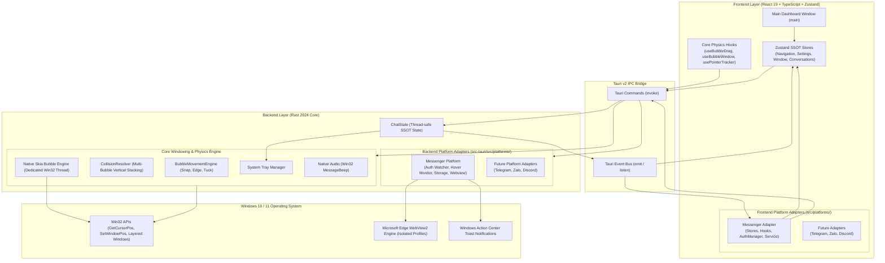

# DesktopBubbleChat

[](https://github.com/RichardLitt/standard-readme)
[-0078D6?style=flat-square&logo=windows)](https://www.microsoft.com/windows)
[](https://tauri.app/)
[](https://react.dev/)
[](https://www.typescriptlang.org/)
[](https://www.rust-lang.org/)
[](https://tailwindcss.com/)
[](LICENSE)

> Extensible, high-performance floating chat heads for Windows Desktop featuring pluggable multi-platform messaging, hardware-accelerated Win32 + Skia vector avatars, physics-driven edge docking, and zero-click interactions.

**DesktopBubbleChat** re-imagines desktop instant messaging by bringing the fluid, non-intrusive mobile chat head experience to Windows 10 and 11 across multiple messaging networks. Built with **Tauri v2**, **React 19**, **TypeScript**, and a native **Rust (Win32 + Skia)** core, DesktopBubbleChat decouples physical windowing, motion physics, and vector rendering from individual platform adapters. It allows running concurrent isolated accounts within dedicated Microsoft WebView2 sandboxes while maintaining an ultra-lightweight footprint (~16 KB RAM per idle floating head).

---

## Table of Contents

- [Security](#security)
- [Background](#background)
- [Multi-Platform Vision & Roadmap](#multi-platform-vision--roadmap)
- [Features](#features)
- [Architecture & Technical Design](#architecture--technical-design)
  - [System Architecture](#system-architecture)
  - [Pluggable Platform Adapter Pattern](#pluggable-platform-adapter-pattern)
  - [Key Technical Concepts](#key-technical-concepts)
- [Project Structure](#project-structure)
- [Install](#install)
  - [Prerequisites](#prerequisites)
  - [Environment Verification](#environment-verification)
  - [Installation Steps](#installation-steps)
- [Usage](#usage)
  - [Development Mode](#development-mode)
  - [Web Preview Mode](#web-preview-mode)
  - [Production Build & Packaging](#production-build--packaging)
  - [Process Management & Stopping](#process-management--stopping)
  - [Resource & Process Monitoring](#resource--process-monitoring)
  - [Asset & Logo Pipeline](#asset--logo-pipeline)
  - [Global Shortcuts & Tray Controls](#global-shortcuts--tray-controls)
- [API](#api)
  - [Core Bubble & Positioning Commands](#core-bubble--positioning-commands)
  - [Core System & Utility Commands](#core-system--utility-commands)
  - [Platform Adapter Commands (Messenger)](#platform-adapter-commands-messenger)
  - [IPC Events](#ipc-events)
- [Troubleshooting & FAQ](#troubleshooting--faq)
- [Maintainers](#maintainers)
- [Contributing](#contributing)
- [License](#license)

---

## Security

DesktopBubbleChat is architected with a strict **local-first security model**:

1. **Zero External Telemetry & Zero Cloud Intermediary**:
   All messaging traffic flows directly between your local Microsoft WebView2 instance and official platform endpoints (e.g., `https://www.messenger.com`). No credentials, tokens, cookies, or chat messages are ever transmitted to any third-party server or external proxy.
2. **Multi-Account & Multi-Platform Profile Sandbox Isolation**:
   Every account profile operates in an isolated user data directory on disk (`com.desktopbubblechat.app/profiles/<platform>_<index>`). Cookies, session tokens, indexedDB records, and local caches never leak across accounts or platforms.
3. **Native Tauri v2 Capabilities & Content Security Policy (CSP)**:
   The application strictly adheres to Tauri v2's capability isolation system ([`capabilities/default.json`](file:///D:/DesktopBubbleChat/src-tauri/capabilities/default.json)), preventing web content from executing arbitrary shell commands or accessing unauthorized file system paths.
4. **Local Windows Credential Storage**:
   Session persistence is managed locally on the user's encrypted Windows account profile. To revoke access, disconnect the account via the Connections tab or call `clear_account_storage`.

To report security vulnerabilities, please open a private GitHub Security Advisory or contact the maintainers directly.

---

## Background

On desktop operating systems, users frequently juggle multiple chat applications across separate browser tabs or heavy Electron wrappers, each consuming hundreds of megabytes of RAM and cluttering the Windows taskbar.

**DesktopBubbleChat** solves this fragmentation through a unified, extensible desktop chat hub:
- **Tauri v2 + Microsoft WebView2**: Shares the operating system's native Evergreen WebView2 runtime, slashing RAM consumption to ~30–50 MB per active chat profile compared to 300–500 MB typical of standalone Electron apps.
- **Pure Rust Win32 + Skia Rendering**: Floating heads run on a dedicated Win32 UI thread utilizing Skia hardware/CPU vector graphics directly onto layered OS windows (`UpdateLayeredWindow`), requiring only ~16 KB RAM per bubble without hosting heavy webview containers for idle avatars.
- **Native Win32 Movement & Physics Core**: Replaces sluggish JavaScript polling with native Windows OS APIs (`GetCursorPos`, `GetAsyncKeyState`, `SetWindowPos`) for 60 FPS edge-snapping, vertical collision avoidance, and zero-click peeking.
- **Pluggable Platform Design**: Clean architectural separation between core desktop windowing/physics and individual messaging platform adapters, enabling rapid integration of new messaging networks without modifying the core windowing engine.

---

## Multi-Platform Vision & Roadmap

DesktopBubbleChat is designed from the ground up as a universal chat-head framework. While **Facebook Messenger** serves as the initial, fully-featured reference platform, the architecture explicitly separates platform concerns to support additional networks:

| Platform | Integration Type | Multi-Account Support | Status |
| :--- | :--- | :--- | :--- |
| **Facebook Messenger** | Isolated WebView2 + Native Rust Daemons | Up to 5 Accounts (Profiles 01–05) | **Available** |
| **Telegram** | Web / TDesktop Adapter | Planned Multi-Account | **Roadmap** |
| **Zalo** | Web Wrapper + Auth Watcher | Planned Multi-Account | **Roadmap** |
| **Discord** | Web Client / Gateway Adapter | Planned Multi-Account | **Roadmap** |

---

## Features

- **Pluggable Multi-Platform Architecture**: Unified core engine separating physical window movement and rendering from individual social platform adapters.
- **Concurrent Multi-Account Isolation**: Run up to 5 concurrent accounts per platform simultaneously in isolated browser sessions without cookie collisions.
- **Pure Rust Win32 + Skia Vector Graphics Engine**: Dedicated lightweight native thread drawing vector platform icons and unread count badges with sub-pixel rendering at ultra-low RAM footprint (~16 KB memory per bubble).
- **Physics-Based Edge Snapping & Tucking**: Drag bubbles freely anywhere on your screen. Releasing a bubble smoothly snaps it to the nearest display edge (left or right) and tucks 75% of the bubble off-screen during idle to preserve desktop workspace.
- **Multi-Bubble Vertical Collision Resolver**: Proprietary collision engine ensures that multiple chat heads docked at the same edge never overlap or obscure each other.
- **Zero-Click Hover Interaction**:
  - **Hover 100ms** on an edge bubble to peek out and automatically pop open the conversation window.
  - **Move cursor away for 1000ms** to automatically close the chat window and glide the bubble back into tucked mode.
  - No clicking required to read or switch between conversations.
- **Native Pop Sound & Windows Toast Notifications**: Rust native audio playback via Win32 `MessageBeep`/`PlaySoundW` and Windows 10/11 native toast notifications with sender names and snippet previews.
- **Modern Fluent UI & Dark/Light Theming**: Clean, responsive dashboard designed with Tailwind CSS, supporting custom title bars, account badges, metrics, and troubleshooting wizards.
- **Global Keyboard Shortcut (`Ctrl+Shift+M`)**: Toggle the visibility of all active floating chat heads instantly from any application or game.
- **Windows System Tray Integration**: Minimizes cleanly to the Windows taskbar tray with quick toggles, status indicators, dynamic account menus, and background persistence.

---

## Architecture & Technical Design

### System Architecture



### Pluggable Platform Adapter Pattern

Both the Frontend and Backend isolate platform-specific code into distinct modules:

| Responsibility | Frontend (`src/platforms/<platform>/`) | Backend (`src-tauri/src/platforms/<platform>/`) |
| :--- | :--- | :--- |
| **Account State** | Platform Zustand stores (`useMessengerStore`) | `ChatState` multi-account map |
| **Auth Lifecycle** | Polling & timeout manager (`messengerAuthManager`) | Window watcher daemon (`auth_watcher.rs`) |
| **UI Integration** | Account hooks (`useMessengerAccounts`) | Dedicated IPC command module (`commands/<platform>/`) |
| **Webview Handling** | IPC calls to open/close chat webviews | Profile data sandbox & window manager (`chat_window.rs`) |
| **DOM / Scraping** | Incoming message & thread event handlers | CSS / JS injection payloads (`messenger_inject.js`) |

### Key Technical Concepts

1. **Dual Window Strategy**:
   - **Main Dashboard Window** (`label: main`): Provides multi-platform account management, connection metrics, recent conversations, preferences, and troubleshooting tools.
   - **Native Chat Head Windows** (Pure Rust + Skia Layered Win32 HWND): Frameless, transparent, hardware-accelerated vector avatars on a dedicated OS thread.
   - **Platform Webview Windows** (`label: chat-<platform>-<index>`): Isolated WebView2 windows docked directly adjacent to their corresponding bubble.
2. **Exclusive Chat Rule**:
   Only one conversation window is visible at any given moment. Hovering over a second bubble immediately hides the first chat window, tucks the first bubble, and summons the second window.
3. **Two-Phase Hide & Tuck Animation**:
   When mouse leaves the chat window, the chat webview hides first, followed by a smooth spring transition tucking the chat head back to the screen boundary, eliminating visual stutter.

---

## Project Structure

```text
DesktopBubbleChat/
├── .vscode/                               # Editor configurations
│   └── extensions.json                    # Recommended VS Code extensions (Rust, Tauri, Tailwind)
├── public/                                # Static web assets
│   ├── app-icon.png                       # Application brand logo (512x512)
│   ├── favicon.ico                        # Browser and webview favicon
│   ├── tauri.svg                          # Tauri brand logo
│   └── vite.svg                           # Vite brand logo
├── scripts/                               # PowerShell automation & lifecycle scripts
│   ├── check_env.ps1                      # Environment diagnostics (Node, Rust, MSVC, WebView2)
│   ├── start.ps1                          # Master launcher (dev, prod, web) with port & process clean
│   └── status.ps1                         # Process monitor & memory tracker for all webviews
├── src/                                   # Frontend Application (React 19 + TypeScript + Tailwind)
│   ├── assets/                            # Static frontend graphics
│   ├── components/                        # Modular React components
│   │   ├── chatheads/                     # Chat Heads workspace & pinned list
│   │   ├── common/                        # Shared UI primitives (Buttons, Cards, Avatars, Dialogs)
│   │   ├── connections/                   # Multi-platform connection manager & status cards
│   │   ├── help/                          # Troubleshooting, FAQs & quick tips
│   │   ├── home/                          # Dashboard homepage, metrics & platform roadmap
│   │   ├── icons/                         # SVG platform icons (Messenger, Telegram, Zalo, Discord)
│   │   ├── layout/                        # Shell layout (TitleBar, Sidebar, Modal Dialogs)
│   │   ├── notifications/                 # Notifications feed & badge clearing dialogs
│   │   └── settings/                      # Preferences (Bubble size, autostart, hotkeys, cache)
│   ├── config/                            # Application configuration & platform definitions
│   ├── constants/                         # Design tokens, account badge colors & physics presets
│   ├── hooks/                             # Custom React hooks (settings, listeners & lifecycle)
│   ├── mocks/                             # Development mocks for offline preview
│   ├── platforms/                         # Pluggable Platform Adapters (Frontend SSOT)
│   │   ├── messenger/                     # Facebook Messenger Platform Module
│   │   │   ├── hooks/                     # Messenger account hooks (useMessengerAccounts)
│   │   │   ├── stores/                    # Messenger account store (useMessengerStore)
│   │   │   ├── services/                  # Messenger IPC client, auth & storage services
│   │   │   ├── types.ts                   # Messenger type contracts
│   │   │   └── index.ts                   # Messenger module exports
│   │   ├── types.ts                       # Common platform adapter contracts (IPlatformAdapter)
│   │   └── index.ts                       # Platform registry & configuration exports
│   ├── services/                          # Generic application services & system IPC
│   │   ├── loggerService.ts               # Unified frontend-to-backend logger
│   │   ├── notificationService.ts         # Windows native notification trigger
│   │   ├── soundService.ts                # Audio effects service
│   │   └── systemService.ts               # Win32 system queries & autostart toggles
│   ├── stores/                            # Generic application Zustand stores
│   │   ├── conversationStore.ts           # Active conversation threads & unread state
│   │   ├── navigationStore.ts             # Active dashboard tab & view state
│   │   ├── settingsStore.ts               # User preferences & physics settings
│   │   ├── systemUserStore.ts             # Logged-in OS user information
│   │   └── windowStore.ts                 # Window handles & focus state
│   ├── types/                             # TypeScript interfaces & typed IPC definitions
│   │   ├── account.ts                     # Account profile & credentials types
│   │   ├── conversation.ts                # Thread & message payload types
│   │   ├── ipc.ts                         # Strongly-typed IPC command & event names
│   │   ├── navigation.ts                  # Navigation route types
│   │   └── platform.ts                    # Social platform metadata & enums
│   ├── App.css                            # Global styles & custom scrollbars
│   ├── App.tsx                            # Root application router (Dashboard vs Bubble Head)
│   ├── index.css                          # Tailwind CSS base & utilities
│   ├── main.tsx                           # React entry point
│   └── vite-env.d.ts                      # Vite type definitions
├── src-tauri/                             # Rust Backend Core & Native OS Integration
│   ├── capabilities/                      # Tauri v2 security ACL policies
│   │   └── default.json                   # Webview, window, shortcut & opener permissions
│   ├── icons/                             # Multi-resolution icons (Windows, macOS, Android, iOS)
│   ├── src/                               # Rust backend source code
│   │   ├── commands/                      # Tauri IPC command handlers
│   │   │   ├── bubble/                    # Core: Bubble window queries, motion, lifecycle & preview
│   │   │   ├── system/                    # Core: System info, autostart, tray status & window controls
│   │   │   ├── messenger/                 # Platform Adapter: Messenger auth, chat & session commands
│   │   │   │   ├── auth.rs                # Login, session verification & disconnect commands
│   │   │   │   ├── chat.rs                # Webview open, preload, toggle & thread navigation
│   │   │   │   └── mod.rs
│   │   │   ├── badge.rs                   # Core: Unread counter & badge sync commands
│   │   │   └── mod.rs                     # Command aggregation & re-exports
│   │   ├── movement/                      # Core: Physics Engine & Multi-Bubble Collision Resolver
│   │   │   ├── collision.rs               # AABB overlap check & vertical collision resolver
│   │   │   ├── config.rs                  # BubblePhysicsConfig, screen metrics & snap calculations
│   │   │   ├── engine.rs                  # Edge calculation, snap points & dismiss logic
│   │   │   └── mod.rs                     # Movement module exports
│   │   ├── platforms/                     # Pluggable Platform Adapters (Backend)
│   │   │   └── messenger/                 # Facebook Messenger Platform Adapter
│   │   │       ├── daemons/               # Win32 background daemons (auth watcher, hover monitor)
│   │   │       ├── scripts/               # Webview injection payloads (custom CSS & DOM scraper)
│   │   │       ├── services/              # Business services (auth, chat, storage)
│   │   │       ├── windows/               # Webview window lifecycle & isolated profile sandboxes
│   │   │       ├── constants.rs           # URLs & selector constants
│   │   │       ├── parser.rs              # Title & DOM parsing utilities
│   │   │       └── verifier.rs            # Session validation utilities
│   │   ├── tray/                          # Core: System tray management
│   │   │   ├── dialog.rs                  # Win32 confirmation modal before exit
│   │   │   ├── helpers.rs                 # Account query & window toggle helpers
│   │   │   ├── menu.rs                    # Dynamic context menu builder
│   │   │   ├── setup.rs                   # Tray initialization & event loop
│   │   │   └── mod.rs
│   │   ├── utils/                         # Core: Native OS utility helpers
│   │   │   ├── native_sound.rs            # Pure native Windows sound playback (MessageBeep)
│   │   │   ├── parser.rs                  # Data parser utilities
│   │   │   ├── time.rs                    # Timestamp helpers
│   │   │   └── win32.rs                   # Win32 API bindings (GetCursorPos, GetAsyncKeyState)
│   │   ├── windows/                       # Core: Window managers
│   │   │   ├── bubble/                    # Webview & Subclass bubble window manager
│   │   │   ├── native_bubble/             # Pure Rust Win32 + Skia floating bubble engine
│   │   │   │   ├── renderer/              # Skia GPU/CPU vector graphics renderer
│   │   │   │   ├── window/                # Dedicated Win32 UI thread & layered window
│   │   │   │   ├── animator.rs            # Cubic-bezier & spring physics animation
│   │   │   │   ├── manager.rs             # Dedicated UI thread worker & event dispatcher
│   │   │   │   └── mod.rs
│   │   │   ├── main_window.rs             # Main dashboard window lifecycle & tray intercept
│   │   │   └── mod.rs
│   │   ├── lib.rs                         # Tauri application builder, plugins, shortcuts & invoke registry
│   │   ├── main.rs                        # Desktop application executable entry point
│   │   └── state.rs                       # Centralized ChatState (SSOT thread-safe app state)
│   ├── build.rs                           # Tauri build script
│   ├── Cargo.lock                         # Deterministic Rust dependency lockfile
│   ├── Cargo.toml                         # Rust package manifest & dependencies
│   └── tauri.conf.json                    # Tauri configuration (window definitions, bundle, security)
├── .gitignore                             # Git ignore rules
├── index.html                             # HTML entry point for Vite
├── LICENSE                                # Open source MIT License terms
├── package.json                           # Node.js project manifest, dependencies & scripts
├── package-lock.json                      # Deterministic npm dependency lockfile
├── postcss.config.js                      # PostCSS configuration
├── README.md                              # Project documentation
├── tailwind.config.js                     # Tailwind CSS configuration
├── tsconfig.json                          # TypeScript compiler configuration
├── tsconfig.node.json                     # TypeScript configuration for Node tooling
└── vite.config.ts                         # Vite bundler configuration & local dev server setup
```

---

## Install

### Prerequisites

Ensure the following toolchains are installed on your Windows machine:

| Tool | Recommended Version | Purpose |
| :--- | :--- | :--- |
| **Windows OS** | Windows 10 (1903+) or Windows 11 (64-bit) | Target operating system |
| **Node.js** | `>= 18.0.0` (LTS recommended) | Frontend compilation & tooling |
| **npm** | `>= 9.0.0` | Package manager |
| **Rust & Cargo** | Stable (1.80+ with `x86_64-pc-windows-msvc`) | Tauri backend compiler |
| **MSVC Build Tools** | Visual Studio Build Tools 2022 (C++ Workload) | Provides `link.exe` linker |
| **WebView2 Runtime** | Evergreen Runtime (Pre-installed on Win 10/11) | Webview rendering engine |

### Environment Verification

Run the built-in diagnostic script to verify your development environment:

```powershell
npm run app:check
# or directly via PowerShell
powershell -ExecutionPolicy Bypass -File scripts/check_env.ps1
```

If any dependency is missing, the diagnostic script will pinpoint the exact missing path and provide remediation steps.

### Installation Steps

1. **Clone the repository**:
   ```bash
   git clone https://github.com/Lelequyngocquy/desktop-bubble-chat.git
   cd desktop-bubble-chat
   ```

2. **Install Node.js dependencies**:
   ```bash
   npm install
   ```

3. **Verify the Rust toolchain**:
   ```bash
   cargo check --manifest-path src-tauri/Cargo.toml
   ```

---

## Usage

### Development Mode

To launch the full desktop application with hot-reloading for both React (Vite) and Rust (Tauri):

```powershell
npm run app:start
# or
powershell -ExecutionPolicy Bypass -File scripts/start.ps1 -Mode dev
```

*The launcher automatically verifies that port 1420 is free, cleans up stale processes, configures the Cargo environment, and starts the Tauri development environment.*

### Web Preview Mode

To preview only the frontend UI inside your default web browser (without launching native desktop chat heads):

```powershell
powershell -ExecutionPolicy Bypass -File scripts/start.ps1 -Mode web
# or
npm run dev
```
Navigate to `http://localhost:1420` in your web browser.

### Production Build & Packaging

To compile optimized frontend assets and generate standalone Windows executables (`.exe`) and installers (`.msi` / NSIS):

```powershell
npm run tauri build
# or via npx
npx tauri build
```

Generated production artifacts:
- **Standalone Binary**: `src-tauri/target/release/DesktopBubbleChat.exe`
- **Installer Bundles**: `src-tauri/target/release/bundle/nsis/` and `src-tauri/target/release/bundle/msi/`

To launch the compiled release executable directly:
```powershell
powershell -ExecutionPolicy Bypass -File scripts/start.ps1 -Mode prod
```

### Process Management & Stopping

To cleanly terminate all running DesktopBubbleChat instances and floating chat heads:

- **Via System Tray**: Right-click the **DesktopBubbleChat** tray icon in the Windows taskbar and choose **Thoát ứng dụng...**.
- **Via Terminal**: Press `Ctrl + C` in the running dev server terminal session.
- **Via PowerShell**:
  ```powershell
  Stop-Process -Name "DesktopBubbleChat" -Force -ErrorAction SilentlyContinue
  ```

### Resource & Process Monitoring

To inspect real-time CPU, RAM, and process tree statistics for all active WebView2 profiles:

```powershell
powershell -ExecutionPolicy Bypass -File scripts/status.ps1
# For continuous live monitoring every 2 seconds:
powershell -ExecutionPolicy Bypass -File scripts/status.ps1 -Watch
```

### Asset & Logo Pipeline

To update the application icon across all supported formats (`.ico`, `.png`, and mobile assets):

```powershell
npm run tauri icon "path/to/your/app-icon.png"
```

### Global Shortcuts & Tray Controls

- **`Ctrl + Shift + M`**: Toggle the visibility of all active floating chat heads.
- **System Tray Icon**: Right-click the tray icon to open the dynamic context menu:
  - **Mở / Đóng Trang chủ**: Toggles the main dashboard configuration window.
  - **Bật / Ẩn tất cả bong bóng**: Master toggle for all active floating chat heads.
  - **Individual Account Toggles**: Toggle individual accounts with active checkmark indicators.
  - **Thoát ứng dụng...**: Displays a Win32 confirmation dialog before clean application shutdown.

---

## API

All commands are strongly typed in [`src/types/ipc.ts`](file:///D:/DesktopBubbleChat/src/types/ipc.ts) and modularized in [`src-tauri/src/commands/`](file:///D:/DesktopBubbleChat/src-tauri/src/commands/).

### Core Bubble & Positioning Commands

| Command | Arguments | Return Type | Description |
| :--- | :--- | :--- | :--- |
| `toggle_bubble` | `visible: boolean`, `accountIndex?: number` | `void` | Show or hide the chat head window for a given account. |
| `toggle_all_bubbles`| `visible?: boolean`, `extraIdx?: number` | `void` | Batch toggle all active chat heads. |
| `snap_bubble` | `accountIndex?: number` | `SnapResult` | Triggers physics calculation and snaps bubble to nearest edge. |
| `get_bubble_position` | `accountIndex?: number` | `PhysicalPosition` | Retrieves the current screen coordinates of a specific bubble. |
| `get_all_bubble_positions` | *none* | `Vec<BubblePositionDto>` | Returns coordinate and visibility data for all bubbles. |
| `get_bubble_snap_coords` | `accountIndex: number`, `currentX: number`, `currentY: number` | `SnapCoordsDto` | Calculates target snap coordinates without moving the window. |
| `get_bubble_hover_coords` | `accountIndex: number`, `isHovered: boolean` | `PhysicalPosition` | Calculates peek (hovered) or tucked coordinates. |
| `set_bubble_config` | `config: BubblePhysicsConfig` | `void` | Updates runtime physics constants (size, gap, tuck ratio). |

### Core System & Utility Commands

| Command | Arguments | Return Type | Description |
| :--- | :--- | :--- | :--- |
| `get_system_username` | *none* | `string` | Retrieves the active Windows user display name via Win32 `NetUserGetInfo`. |
| `toggle_autostart` | `enable: boolean` | `void` | Configures application autostart with Windows Registry / Startup. |
| `is_autostart_enabled` | *none* | `boolean` | Checks whether startup on boot is currently active. |
| `minimize_main_window`| *none* | `void` | Minimizes the main dashboard window to the taskbar. |
| `hide_main_window` | *none* | `void` | Hides the main dashboard to the system tray. |
| `exit_app` | *none* | `void` | Performs clean termination of all threads, daemons, and windows. |

### Platform Adapter Commands (Messenger)

| Command | Arguments | Return Type | Description |
| :--- | :--- | :--- | :--- |
| `open_messenger_auth` | `accountIndex?: number` | `void` | Opens an independent popup window for user authentication. |
| `check_messenger_auth` | `accountIndex?: number` | `AuthStatusDto` | Queries current session validity and logged-in account name. |
| `disconnect_messenger` | `accountIndex?: number` | `void` | Logs out the specified account and clears session state. |
| `open_chat` | `accountIndex?: number` | `void` | Opens the platform chat window next to the active bubble. |
| `preload_chat` | `accountIndex?: number` | `void` | Silently warms up the WebView2 instance in the background. |
| `toggle_chat` | `accountIndex?: number` | `void` | Toggles the visibility of the conversation window. |
| `open_thread` | `threadId: string`, `accountIndex?: number` | `void` | Opens a specific conversation thread directly. |
| `report_new_message` | `senderName: string`, `body?: string`, `accountIndex?: number` | `void` | Dispatches message arrival event, plays pop sound, and triggers toast. |
| `sync_recent_conversations` | `conversations: IncomingMessageDto[]`, `accountIndex?: number` | `void` | Ingests recent conversation threads scraped from the webview. |
| `clear_account_storage` | `accountIndex?: number` | `void` | Deletes the WebView2 user data folder for a specific account. |

### IPC Events

| Event Name | Direction | Payload | Description |
| :--- | :--- | :--- | :--- |
| `badge-updated` | Rust -> Frontend | `{ accountIndex: number, count: number }` | Fired when the unread message count changes. |
| `messenger-auth-status`| Rust -> Frontend | `{ accountIndex: number, connected: boolean, name?: string }` | Emitted when authentication state changes. |
| `chat-visibility-changed` | Rust -> Frontend | `{ accountIndex: number, visible: boolean }` | Notifies bubble components when a chat window is shown or hidden. |
| `bubble-visibility-changed` | Rust -> Frontend | `{ accountIndex: number, visible: boolean }` | Synchronizes bubble toggle switches in the UI. |
| `new-message-received` | Rust -> Frontend | `IncomingMessageDto` | Broadcasts incoming messages for live toast and dashboard feeds. |
| `recent-conversations-synced` | Rust -> Frontend | `{ accountIndex: number, conversations: [...] }` | Syncs recent threads into the frontend conversation store. |

---

## Troubleshooting & FAQ

### 1. Port 1420 is already in use
- **Cause**: A previous Vite or Tauri dev server did not exit cleanly.
- **Solution**: Terminate existing processes using `Stop-Process -Name "DesktopBubbleChat" -Force -ErrorAction SilentlyContinue` or close the previous terminal. Running `scripts/start.ps1` also automatically checks and frees port 1420 before launching.

### 2. File lock error on `msedgewebview2.exe` during build
- **Cause**: An orphaned WebView2 background process still holds a lock on the `EBWebView` cache directory.
- **Solution**: Exit the application via the System Tray -> **Thoát ứng dụng...**, or kill any lingering WebView2 processes in PowerShell:
  ```powershell
  Get-Process msedgewebview2 -ErrorAction SilentlyContinue | Where-Object { $_.CommandLine -like "*com.desktopbubblechat.app*" } | Stop-Process -Force
  ```

### 3. Rust build fails with `link.exe not found`
- **Cause**: The Microsoft Visual C++ MSVC linker is missing from your system PATH.
- **Solution**: Install **Visual Studio Build Tools 2022** with the **Desktop development with C++** workload. Run `npm run app:check` to confirm detection.

### 4. Bubbles do not tuck properly on multi-monitor setups
- **Cause**: Display DPI scaling factors or virtual desktop boundaries differ between displays.
- **Solution**: The Rust movement engine queries monitor boundaries via `tauri::Monitor`. Ensure the bubble is positioned on the active display, or reset positions via the **Chat Heads** tab in the dashboard.

---

## Maintainers

- **Le Quy Ngoc Quy** ([@Lelequyngocquy](https://github.com/Lelequyngocquy))

---

## Contributing

Contributions, feature requests, and bug reports are welcome!

1. Fork the Project.
2. Create your Feature Branch:
   ```bash
   git checkout -b feat/amazing-feature
   ```
3. Commit your Changes using Conventional Commits:
   ```bash
   git commit -m "feat(physics): enhance vertical collision padding"
   ```
4. Push to the Branch:
   ```bash
   git push origin feat/amazing-feature
   ```
5. Open a Pull Request.

Please ensure that `npm run build` and `cargo check --manifest-path src-tauri/Cargo.toml` succeed before opening a PR.

---

## License

This project is licensed under the **MIT License** - see the [LICENSE](LICENSE) file for details.
