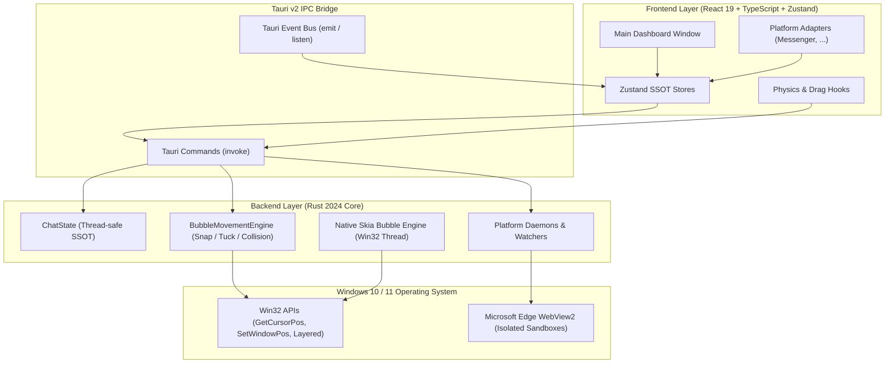

# DesktopBubbleChat

[-0078D6?style=flat-square&logo=windows)](https://www.microsoft.com/windows)
[](https://tauri.app/)
[](https://react.dev/)
[](https://www.typescriptlang.org/)
[](https://www.rust-lang.org/)
[](LICENSE)

> Extensible, high-performance floating chat heads for Windows Desktop featuring pluggable multi-platform messaging, hardware-accelerated Win32 + Skia vector avatars, physics-driven edge docking, and zero-click interactions.

**English** | [Tiếng Việt](README.vi.md)

---

**DesktopBubbleChat** brings the fluid, non-intrusive mobile chat head experience to Windows 10 and 11 across multiple messaging networks. Built with **Tauri v2**, **React 19**, **TypeScript**, and a native **Rust (Win32 + Skia)** core, it decouples windowing, physics, and rendering from platform adapters. It runs concurrent isolated profiles inside dedicated Microsoft WebView2 sandboxes while keeping a smooth, responsive desktop experience.

### Table of Contents
- [Key Features](#key-features)
- [Architecture Overview](#architecture-overview)
- [Roadmap](#roadmap)
- [Getting Started](#getting-started)
- [Usage & Shortcuts](#usage--shortcuts)
- [Security Model](#security-model)
- [Troubleshooting](#troubleshooting)
- [Maintainers](#maintainers)
- [Contributing](#contributing)
- [License](#license)

---

### Key Features

- **Pluggable Multi-Platform Architecture**: Unified core engine separating physical window movement and rendering from individual social platform adapters.
- **Concurrent Multi-Account Isolation**: Run up to 5 concurrent accounts per platform in isolated browser sessions without cookie collisions.
- **Pure Rust Win32 + Skia Vector Engine**: Dedicated native thread drawing vector platform icons and unread count badges with sub-pixel anti-aliased rendering.
- **Physics-Based Edge Snapping & Tucking**: Smoothly snaps to screen edges and tucks 75% of the bubble off-screen when idle to save screen space.
- **Vertical Collision Resolver**: Automatic repositioning ensures stacked bubbles docked on the same edge never overlap.
- **Zero-Click Hover Interaction**:
  - **Hover (100ms)** to peek out and pop open the conversation window.
  - **Leave cursor (1000ms)** to automatically close the chat window and glide the bubble back into tucked mode.
- **Native Notifications & Audio**: Integrated with Windows Action Center toasts and native Win32 audio cues.
- **Global Shortcut & Tray Integration**: Instant visibility toggle (`Ctrl + Shift + M`) and dynamic system tray controls.

---

### Architecture Overview



<details>
<summary><b>Click to view Project Structure</b></summary>

```text
DesktopBubbleChat/
├── scripts/                    # Automation scripts (check_env.ps1, start.ps1, status.ps1)
├── src/                        # Frontend Application (React 19 + TypeScript + Tailwind)
│   ├── components/             # Dashboard, chat heads workspace, settings & UI primitives
│   ├── platforms/              # Modular Frontend Platform Adapters (e.g. messenger/)
│   ├── stores/                 # Zustand state stores
│   ├── services/               # IPC client, notifications, and audio services
│   └── types/                  # Typed IPC contracts and domain interfaces
├── src-tauri/                  # Rust Backend Core & Native OS Integration
│   ├── capabilities/           # Tauri v2 security ACL policies
│   ├── src/
│   │   ├── commands/           # IPC command handlers (bubble, system, platforms)
│   │   ├── movement/           # Physics engine, snap calculations & collision resolver
│   │   ├── platforms/          # Backend Platform Adapters (daemons, scrapers, webview lifecycle)
│   │   ├── tray/               # System tray setup & dynamic context menus
│   │   ├── windows/            # Skia rendering engine & Win32 native window management
│   │   └── state.rs            # Centralized thread-safe app state
│   ├── Cargo.toml              # Rust dependencies manifest
│   └── tauri.conf.json         # Tauri v2 configuration
└── package.json
```
</details>

---

### Roadmap

| Platform | Integration Type | Multi-Account Support | Status |
| :--- | :--- | :--- | :--- |
| **Facebook Messenger** | Isolated WebView2 + Native Daemons | Up to 5 Accounts (Profiles 01–05) | **Available** |
| **Telegram** | Web / TDesktop Adapter | Planned Multi-Account | **Roadmap** |
| **Zalo** | Web Wrapper + Auth Watcher | Planned Multi-Account | **Roadmap** |
| **Discord** | Web Client / Gateway Adapter | Planned Multi-Account | **Roadmap** |

---

### Getting Started

#### Prerequisites
- **Windows 10 (1903+) or Windows 11 (64-bit)**
- **Node.js**: `>= 18.0.0`
- **Rust & Cargo**: Stable (1.80+ with `x86_64-pc-windows-msvc`)
- **Visual Studio Build Tools 2022** (C++ Workload)
- **Microsoft Edge WebView2 Runtime** (Evergreen)

#### Installation & Setup

1. **Clone the repository**:
   ```bash
   git clone https://github.com/Lelequyngocquy/desktop-bubble-chat.git
   cd desktop-bubble-chat
   ```

2. **Install dependencies**:
   ```bash
   npm install
   ```

3. **Verify your build environment**:
   ```powershell
   npm run app:check
   ```

4. **Run in development mode**:
   ```powershell
   npm run app:start
   ```

5. **Build for production**:
   ```powershell
   npm run tauri build
   ```

---

### Usage & Shortcuts

- **`Ctrl + Shift + M`**: Master hotkey to toggle visibility of all floating bubbles.
- **System Tray Menu**: Right-click the taskbar tray icon to:
  - Toggle Main Dashboard
  - Show / Hide All Bubbles
  - Toggle individual accounts
  - Exit Application cleanly
- **Resource Monitoring**:
  Inspect live RAM and WebView2 usage across profiles:
  ```powershell
  powershell -ExecutionPolicy Bypass -File scripts/status.ps1 -Watch
  ```

---

### Security Model

1. **Zero Cloud Intermediaries**: Messaging data flows strictly between your local client and official endpoints (e.g., `https://www.messenger.com`). No telemetry, tokens, or messages touch third-party servers.
2. **Profile Isolation**: Each account operates in an isolated user data directory (`profiles/<platform>_<index>`). Sessions, cookies, and local storage never mix.
3. **Strict Tauri Permissions**: Strict ACL capability policies (`src-tauri/capabilities/default.json`) prevent unauthorized shell or file system operations.

---

### Troubleshooting

- **Port 1420 In Use**: Run `Stop-Process -Name "DesktopBubbleChat" -Force -ErrorAction SilentlyContinue` or launch via `npm run app:start` (which automatically clears stale ports).
- **WebView2 Process Locked**: If builds fail due to file locks on `msedgewebview2.exe`, right-click the system tray and select **Exit Application**, or terminate via PowerShell:
  ```powershell
  Get-Process msedgewebview2 -ErrorAction SilentlyContinue | Where-Object { $_.CommandLine -like "*com.desktopbubblechat.app*" } | Stop-Process -Force
  ```
- **Rust Linker Missing (`link.exe`)**: Install Visual Studio Build Tools 2022 with the "Desktop development with C++" component.

---

## Maintainers

- **Le Ngoc Quy** ([@Lelequyngocquy](https://github.com/Lelequyngocquy))

---

## Contributing

Contributions, issues, and feature requests are welcome!

1. Fork the Project
2. Create your Feature Branch (`git checkout -b feature/AmazingFeature`)
3. Commit your Changes (`git commit -m 'feat: Add some AmazingFeature'`)
4. Push to the Branch (`git push origin feature/AmazingFeature`)
5. Open a Pull Request

---

## License

Distributed under the **MIT License**. See [LICENSE](LICENSE) for more information.
