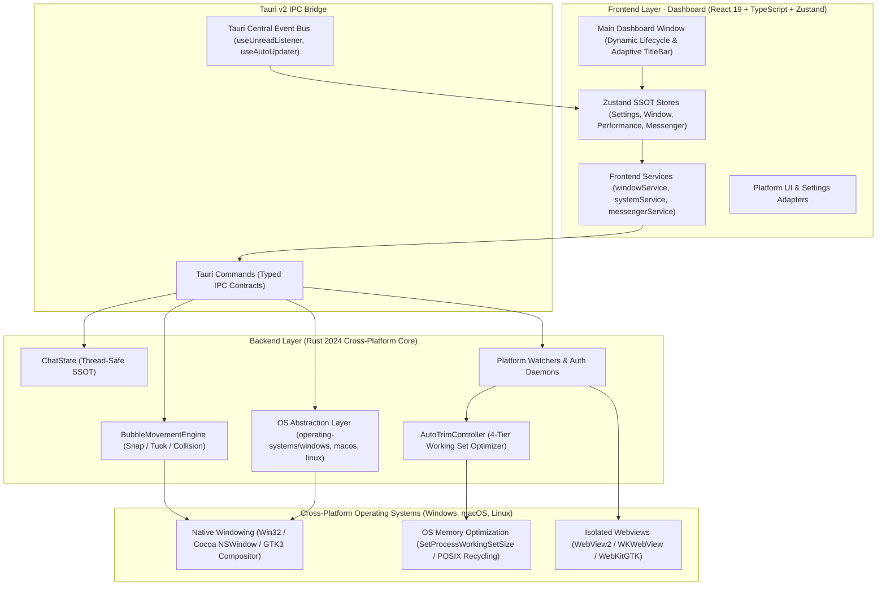

# DesktopBubbleChat

[](#download)
[](#download)
[](#download)
[](https://tauri.app/)
[](https://react.dev/)
[](https://www.typescriptlang.org/)
[](https://www.rust-lang.org/)
[](LICENSE)

> Extensible, high-performance floating chat heads for Desktop (Windows, macOS, Linux) featuring isolated multi-account Messenger integration, hardware-accelerated vector avatars, intelligent 4-tier RAM trimming, physics-driven edge docking, and zero-click interactions.

**English** | [Tiếng Việt](README.vi.md)

---

**DesktopBubbleChat** brings the fluid, non-intrusive mobile chat head experience to **Windows**, **macOS**, and **Linux**. Built with **Tauri v2**, **React 19**, **TypeScript**, and a native **Rust (Hardware & OS Abstraction Layer)** core, it decouples windowing, physics, and rendering from platform adapters. It runs concurrent isolated profiles inside dedicated Webview sandboxes while keeping memory overhead exceptionally low via automated working-set trimming.

### Table of Contents

- [Demo](#demo)
- [Download & Installation](#download)
  - [Pre-built Packages](#download)
  - [OS Installation Notes & User Troubleshooting](#os-installation-notes--user-troubleshooting)
- [Key Features](#key-features)
- [Architecture Overview](#architecture-overview)
- [Getting Started (Building from Source)](#getting-started-building-from-source)
  - [Prerequisites](#prerequisites)
  - [Installation & Setup](#installation--setup)
  - [Developer Troubleshooting](#developer-troubleshooting)
- [Usage & Shortcuts](#usage--shortcuts)
- [Security Model](#security-model)
- [Maintainers](#maintainers)
- [Contributing](#contributing)
- [Disclaimer](#disclaimer)
- [License](#license)

---

## Demo


---

## Download

Official production release **v1.0.1** packages:

| Operating System | Package Format | Download Link | Architecture |
| :--- | :--- | :--- | :--- |
| **Windows 10 / 11** | Installer `.exe` | [DesktopBubbleChat_1.0.1_x64-setup.exe](https://github.com/Lelequyngocquy/desktop-bubble-chat/releases/download/v1.0.1/DesktopBubbleChat_1.0.1_x64-setup.exe) | x86_64 |
| **macOS (Universal)** | Disk Image `.dmg` | [DesktopBubbleChat_1.0.1_universal.dmg](https://github.com/Lelequyngocquy/desktop-bubble-chat/releases/download/v1.0.1/DesktopBubbleChat_1.0.1_universal.dmg) | Apple Silicon (M1/M2/M3/M4) & Intel (`x86_64`) |
| **Linux (Debian/Ubuntu)** | Package `.deb` | [DesktopBubbleChat_1.0.1_amd64.deb](https://github.com/Lelequyngocquy/desktop-bubble-chat/releases/download/v1.0.1/DesktopBubbleChat_1.0.1_amd64.deb) | x86_64 (`amd64`) |
| **Linux (Fedora/RHEL)** | Package `.rpm` | [DesktopBubbleChat-1.0.1-1.x86_64.rpm](https://github.com/Lelequyngocquy/desktop-bubble-chat/releases/download/v1.0.1/DesktopBubbleChat-1.0.1-1.x86_64.rpm) | x86_64 |
| **Linux (All Distros)** | Portable `.AppImage` | [DesktopBubbleChat_1.0.1_amd64.AppImage](https://github.com/Lelequyngocquy/desktop-bubble-chat/releases/download/v1.0.1/DesktopBubbleChat_1.0.1_amd64.AppImage) | x86_64 (`amd64`) |

<details>
<summary><b>SHA-256 Checksums & Signatures</b></summary>

```text
dcaf163f11f5088cf2f58b1188cbe2d2cfbff35271e3e5478cea7e76d515334f  DesktopBubbleChat_1.0.1_x64-setup.exe
194b36323ffebe44c140994dca0152e5f95e983979ca57c346f8d8bdb19ee47d  DesktopBubbleChat_1.0.1_universal.dmg
160ab4cdaa197c4008049a305e18836f2d403892b18ddc241f1672da55cc0b5b  DesktopBubbleChat_1.0.1_amd64.deb
8208c8e7f4e3e5779d8e28fc5a20b127a0cc5728c334512e6019c4f739463029  DesktopBubbleChat-1.0.1-1.x86_64.rpm
2b5749307cfbab8d596ebc90e3ada572348c71c931a0968d299f767d74c7dcf4  DesktopBubbleChat_1.0.1_amd64.AppImage
4a606d6b62e0f0e2759ac676e52e337139fe29f2571b8a7bd8b8ce0f0f9248c1  DesktopBubbleChat_1.0.1_universal.app.tar.gz
```

</details>

**All Releases & Changelog**: [GitHub Releases](https://github.com/Lelequyngocquy/desktop-bubble-chat/releases)

### OS Installation Notes & User Troubleshooting

Guide for users installing pre-compiled releases on their desktop:

#### 🪟 Windows
- **SmartScreen Warning**: If Windows Defender SmartScreen displays *"Windows protected your PC"* (common for new open-source binaries without an expensive EV certificate), click **"More info"** and choose **"Run anyway"**.
- **WebView2 Evergreen Runtime**: Pre-installed on Windows 10/11. If running on a stripped or legacy Windows edition, download and install the official [Microsoft Edge WebView2 Evergreen Bootstrapper](https://developer.microsoft.com/en-us/microsoft-edge/webview2/).

#### 🍎 macOS
- **Gatekeeper / "App Damaged" Warning**:
  Because binary releases are not notarized with a paid Apple Developer ID, macOS Gatekeeper may block launch or warn:
  > *"DesktopBubbleChat is damaged and can’t be opened. You should move it to the Trash."*

  To clear the quarantine attribute and allow DesktopBubbleChat to run, open **Terminal** and execute:
  ```bash
  xattr -cr /Applications/DesktopBubbleChat.app
  ```
- **Accessibility & Hover Tracking Permissions**:
  To enable seamless mouse hover slide-out and the global shortcut across all desktop spaces:
  1. Open **System Settings** > **Privacy & Security** > **Accessibility**.
  2. Toggle **DesktopBubbleChat** to **ON**.

#### 🐧 Linux
- **Running `.AppImage` on Ubuntu 22.04+ (FUSE 2 requirement)**:
  Modern Ubuntu versions do not ship `libfuse2` by default. If double-clicking the `.AppImage` does not launch:
  ```bash
  sudo apt update && sudo apt install libfuse2
  chmod +x DesktopBubbleChat_1.0.1_amd64.AppImage
  ./DesktopBubbleChat_1.0.1_amd64.AppImage
  ```
- **Installing `.deb` Package (Debian / Ubuntu / Mint)**:
  Install using `apt` so package dependencies are automatically resolved:
  ```bash
  sudo apt install ./DesktopBubbleChat_1.0.1_amd64.deb
  ```
  *(If installed via `dpkg -i` and dependencies are missing, run `sudo apt-get install -f` to repair).*
- **Installing `.rpm` Package (Fedora / RHEL / openSUSE)**:
  ```bash
  sudo dnf install ./DesktopBubbleChat-1.0.1-1.x86_64.rpm
  ```
- **GNOME Shell System Tray Icon**:
  Default GNOME Shell hides standard tray icons. To display the DesktopBubbleChat tray icon:
  ```bash
  sudo apt install gnome-shell-extension-appindicator
  ```
  *(Note: DesktopBubbleChat features **Smart Minimize** and an in-bubble settings menu, so the app remains fully operable even without a system tray extension).*


---

### Key Features

- **Cross-Platform Native Vector Avatars & Floating Window Engine**:
  - Floating bubbles are **native, borderless, transparent OS windows** rendered via hardware-accelerated vector graphics (**Tiny-Skia 2D vector engine** and native OS windowing).
  - **Windows**: Dedicated Win32 layered windows with per-pixel alpha, sub-pixel anti-aliasing, and raw Skia rendering.
  - **macOS**: Native Cocoa transparent `NSWindow` integration with Retina-crisp vector scaling.
  - **Linux**: Native GTK / X11-Wayland transparent window composition with compositor fallbacks.
  - Zero Webview overhead for bubbles: no black borders, no compositor lag, and silky-smooth 60 FPS spring physics.
- **Adaptive Desktop UI & Native TitleBar**:
  - **macOS Traffic Lights**: Native top-left traffic lights (Close, Minimize, Maximize) with hover symbols, centered window title and branding, mimicking first-class macOS apps.
  - **Windows & Linux Controls**: Fluent rectangular action buttons on the top-right matching platform desktop conventions.
  - **System Typography**: Automatically adopts native system fonts (Apple SF Pro on macOS, Segoe UI Variable on Windows, Ubuntu / Noto Sans on Linux).
- **Intelligent 4-Tier Auto-Trim Memory Management**:
  - Automatically manages Virtual Memory across host and Webview processes (`SetProcessWorkingSetSize` on Windows, POSIX memory recycling & process lifecycle management on macOS/Linux).
  - **Dynamic Webview Memory Target Level**: Automatically toggles memory usage target level between `Low` (when tucked or idle) and `Normal` (when active) to force Chromium / WebKit to purge V8 JavaScript heap, decode caches, and font buffers.
  - **Stripped Webview Background Services & Process Limiter**: Injected startup flags (`--renderer-process-limit=1`, `--disable-features=Translate,OptimizationHints,CalculateNativeWinOcclusion,...`, `--disable-3d-apis`, strict cache limits) and stripped Webview settings to completely eliminate redundant background processes.
  - **4 automated triggers**: 3s after bubble tucks, 2s after receiving an unread message, 5s after session preload finishes, and an idle sweeper every 5 minutes.
  - **Dynamic Dashboard Destruction**: Closing or minimizing the main dashboard destroys its window down to **0 MB RAM** (only background headless message workers persist).
  - Trims total RAM footprint from typical 500–700 MB down to **80–140 MB**.
- **Real-Time Performance Dashboard**:
  - Live per-process RAM breakdown (Host Rust, Dashboard UI, Webview instances, GPU processes).
  - Single-click manual memory flush ("Trim Memory") with live recovery metric.
- **Auto-Seen Prevention & Background Shield**:
  - Overrides `document.hasFocus()` and mocks DOM blur on window hide to prevent Meta Messenger Web from auto-marking unread messages as "Seen" while the chat window is hidden.
  - Multi-tier unread counter guard prevents title-flashing from wiping unread badges prematurely.
- **Concurrent Multi-Account Isolation**:
  - Run up to 5 concurrent accounts per platform in isolated browser data partitions (`profiles/<platform>_<index>`).
  - No cookie collisions, cross-account logouts, or session leakage.
- **Physics-Based Edge Snapping & Tucking**:
  - Smoothly snaps to screen edges and tucks 75% of the bubble off-screen when idle to save screen real estate.
  - Collision resolver prevents stacked bubbles from overlapping.
- **Zero-Click Hover Interaction**:
  - **Hover (100ms)** to glide out and open the docked conversation window.
  - **Leave cursor (1000ms)** to automatically close the chat window and glide the bubble back into tucked mode.
- **Cryptographically Secured In-App Auto-Updates**:
  - Integrated Tauri Updater signed with **Minisign (Ed25519)** keys to prevent malicious binary tampering.
  - Visual download progress and release notes viewer in Settings.
- **Full Personalization & System Integration**:
  - **Dark / Light Mode**: Seamless system sync with manual toggle.
  - **Bilingual Interface**: Full English and Vietnamese support with runtime reactive switching.
  - **Customizable Bubble Size**: Small (48px), Medium (56px), and Large (64px).
  - **Configurable Close Action**: Ask each time, hide to tray, or exit completely.
  - **Dual Global Hotkey (`Ctrl + Shift + M / ⌘ + Shift + M`)**: Instant toggle for all floating bubbles across Windows, macOS, and Linux.
  - **Native Notifications & Audio**: Native OS notifications (Windows Action Center, macOS Notification Center, Linux Freedesktop) + per-account audio muting.
  - **Cross-Platform Profile Access**: One-click "Open Data Folder" opens user profile storage in the native file manager (Explorer, Finder, or file manager on Linux).

---

### Architecture Overview



<details>
<summary><b>Click to view Project Structure</b></summary>

```text
DesktopBubbleChat/
├── locales/                    # Bilingual i18n translation resources (en/, vi/)
├── scripts/                    # Cross-platform Node.js automation (start, stop, build, status, check-env)
├── src/                        # Frontend Application (React 19 + TypeScript + Tailwind)
│   ├── components/             # Dashboard views, adaptive TitleBar, settings sections & UI primitives
│   ├── hooks/                  # Global listeners (useUnreadListener, useAutoUpdater, ...)
│   ├── i18n/                   # i18next runtime initialization & reactive language switching
│   ├── platforms/              # Modular Frontend Platform Adapters (e.g. messenger/)
│   ├── stores/                 # Zustand state stores (settings, window, performance, ...)
│   ├── services/               # windowService, systemService, messengerService, ...
│   └── types/                  # Typed IPC contracts, domain models, and performance types
├── src-tauri/                  # Rust Backend Core & Multi-OS Integration
│   ├── capabilities/           # Tauri v2 security ACL policies
│   ├── src/
│   │   ├── commands/           # IPC command handlers (bubble, system, platforms)
│   │   ├── core/               # Domain state, models, and business logic
│   │   ├── movement/           # Physics engine, snap calculations & collision resolver
│   │   ├── operating-systems/  # OS-specific implementations (windows/, macos/, linux/)
│   │   ├── platforms/          # Platform adapters (auth watchers, scrapers, lifecycle)
│   │   ├── presentation/       # Window creation & presentation (main, bubble, chat)
│   │   ├── tray/               # System tray setup & dynamic context menus
│   │   └── utils/              # Memory trimming (AutoTrimController), user_cache, paths
│   ├── Cargo.toml              # Rust dependencies manifest
│   └── tauri.conf.json         # Tauri v2 multi-OS configuration
└── package.json
```

</details>

---

### Getting Started (Building from Source)

#### Prerequisites

- **All Platforms**:
  - **Node.js**: `>= 18.0.0`
  - **Rust & Cargo**: Stable (1.80+)

- **Windows**:
  - **Windows 10 (1903+) or Windows 11 (64-bit)**
  - **Visual Studio Build Tools 2022** (Desktop development with C++ workload)
  - **Microsoft Edge WebView2 Runtime** (Evergreen)

- **macOS**:
  - **macOS 10.15 (Catalina) or later** (Apple Silicon `aarch64` or Intel `x86_64`)
  - **Xcode Command Line Tools**: `xcode-select --install`

- **Linux**:
  - **Ubuntu 20.04+, Debian 11+, Fedora 36+, or Arch Linux**
  - **Required GTK & WebKit development packages**:
    - **Debian / Ubuntu**:
      ```bash
      sudo apt install libwebkit2gtk-4.1-dev build-essential curl wget file libssl-dev libayatana-appindicator3-dev librsvg2-dev
      ```
    - **Fedora**:
      ```bash
      sudo dnf install webkit2gtk4.1-devel openssl-devel libappindicator-gtk3-devel librsvg2-devel
      ```
    - **Arch Linux**:
      ```bash
      sudo pacman -S webkit2gtk-4.1 libappindicator-gtk3 librsvg
      ```

#### Installation & Setup

1. **Clone the repository**:

   ```bash
   git clone https://github.com/Lelequyngocquy/desktop-bubble-chat.git
   cd desktop-bubble-chat
   ```

2. **Install dependencies**:

   ```bash
   npm install
   ```

3. **Verify build environment**:

   ```bash
   npm run app:check
   ```

4. **Run in development mode**:

   ```bash
   npm run app:start
   ```

5. **Build for production**:

   ```bash
   npm run app:build
   # or: npm run tauri build
   ```

6. **Stop background processes**:

   ```bash
   npm run app:stop
   ```

#### Developer Troubleshooting

- **Port 1420 In Use or Zombie Background Process**:
  If the Vite dev server fails to bind to port 1420 due to a lingering process:
  ```bash
  npm run app:stop
  ```
  *(Launching via `npm run app:start` also automatically detects and purges stale ports).*
- **Binary / WebView Process Locked During Build**:
  If `npm run app:build` fails because `DesktopBubbleChat.exe` or `msedgewebview2.exe` is still open in the background, terminate them with:
  ```bash
  npm run app:stop
  ```
- **Rust Linker Missing**:
  - **Windows (`link.exe not found`)**: Install Visual Studio Build Tools 2022 and select the "Desktop development with C++" workload.
  - **macOS (`clang not found`)**: Run `xcode-select --install` in Terminal.
  - **Linux (`cc / ld not found`)**: Install build essentials via `sudo apt install build-essential pkg-config`.

---

### Usage & Shortcuts

- **`Ctrl + Shift + M / ⌘ + Shift + M`**: Master hotkey to toggle visibility of all floating bubbles across Windows, macOS, and Linux.
- **Hover on Bubble**: Slides out and opens docked conversation window.
- **Leave Cursor**: Slides chat back into docked edge tucking.
- **System Tray Menu**: Right-click the system tray icon to:
  - Toggle Main Dashboard
  - Show / Hide All Bubbles
  - Toggle individual accounts
  - Exit Application cleanly
- **Resource Monitoring**:
  Inspect live RAM and WebView usage across profiles via the in-app **Performance Dashboard** or cross-platform CLI:
  ```bash
  npm run app:perf -- --watch
  ```

---

### Security Model

1. **Zero Cloud Intermediaries**: Messaging data flows strictly between your local client and official endpoints (`https://www.messenger.com`). No telemetry, tokens, or messages touch third-party servers.
2. **Profile Isolation**: Each account operates in an isolated user data directory (`profiles/<platform>_<index>`). Sessions, cookies, and local storage never mix.
3. **Cryptographic Updates**: In-app updater verifies binary signatures using **Minisign Ed25519** public keys prior to execution.
4. **Strict Tauri Permissions**: Strict ACL capability policies (`src-tauri/capabilities/default.json`) prevent unauthorized shell or file system operations.

---

## Maintainers

- **Le Ngoc Quy** ([@Lelequyngocquy](https://github.com/Lelequyngocquy))

---

## Contributing

Contributions, issues, and feature requests are welcome!

1. Fork the Project
2. Create your Feature Branch (`git checkout -b feature/AmazingFeature`)
3. Commit your Changes (`git commit -m 'feat: Add some AmazingFeature'`)
4. Push to the Branch (`git push origin feature/AmazingFeature`)
5. Open a Pull Request

---

## Disclaimer

DesktopBubbleChat is an independent open-source project plays a role as mini BROWSER, and is not affiliated, associated, authorized, endorsed by, or in any way officially connected with Meta Platforms, Inc., or Facebook Messenger. The official Messenger website can be found at https://www.messenger.com.

---

## License

Distributed under the **MIT License**. See [LICENSE](LICENSE) for more information.
