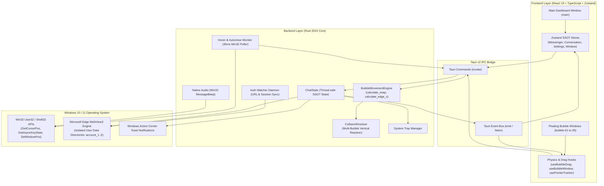

# DesktopBubbleChat

[](https://github.com/RichardLitt/standard-readme)
[-0078D6?style=flat-square&logo=windows)](https://www.microsoft.com/windows)
[](https://tauri.app/)
[](https://react.dev/)
[](https://www.typescriptlang.org/)
[](https://www.rust-lang.org/)
[](https://tailwindcss.com/)
[](LICENSE)

> Lightweight, high-performance floating Messenger chat heads for Windows Desktop with multi-account isolation, physics-driven edge docking, and zero-click interactions.

**DesktopBubbleChat** brings the fluid, non-intrusive mobile chat head experience back to Windows 10 and 11. Built with **Tauri v2**, **React 19**, **TypeScript**, and a native **Rust (Win32)** core, DesktopBubbleChat runs up to 5 concurrent Facebook Messenger accounts within isolated WebView2 profiles while maintaining a minimal memory and CPU footprint.

---

## Table of Contents

- [Security](#security)
- [Background](#background)
- [Features](#features)
- [Architecture & Technical Design](#architecture--technical-design)
- [Project Structure](#project-structure)
- [Install](#install)
  - [Prerequisites](#prerequisites)
  - [Environment Verification](#environment-verification)
  - [Installation Steps](#installation-steps)
- [Usage](#usage)
  - [Development Mode](#development-mode)
  - [Web Preview Mode](#web-preview-mode)
  - [Production Build & Packaging](#production-build--packaging)
  - [Process Management & Stopping](#process-management--stopping)
  - [Resource & Process Monitoring](#resource--process-monitoring)
  - [Asset & Logo Pipeline](#asset--logo-pipeline)
  - [Global Shortcuts & Tray Controls](#global-shortcuts--tray-controls)
- [API](#api)
  - [Tauri IPC Commands](#tauri-ipc-commands)
  - [IPC Events](#ipc-events)
- [Testing & Automation](#testing--automation)
- [Troubleshooting & FAQ](#troubleshooting--faq)
- [Maintainers](#maintainers)
- [Contributing](#contributing)
- [License](#license)

---

## Security

DesktopBubbleChat is designed with a strict **local-first security model**:

1. **Zero External Telemetry & Zero Cloud Intermediary**:
   All communication occurs directly between your local Microsoft WebView2 instance and official Meta Facebook Messenger endpoints (`https://www.messenger.com`). No tokens, cookies, passwords, or message contents are ever sent to any third-party server or external proxy.
2. **Multi-Account Profile Sandbox Isolation**:
   Each Messenger account operates inside its own isolated user data directory (`com.desktopbubblechat.app/messenger_account_X`). Cookies, session tokens, indexedDB records, and cache do not leak across different accounts.
3. **Native Tauri v2 Capabilities & Content Security Policy (CSP)**:
   The application adheres to Tauri v2's permission isolation system ([`capabilities/default.json`](file:///D:/DesktopBubbleChat/src-tauri/capabilities/default.json)), preventing untrusted web content from executing arbitrary shell commands or accessing unauthorized file system paths.
4. **Local Windows Credential Storage**:
   Persistent session state is preserved locally on the user's encrypted Windows account profile. To revoke access, click **Disconnect Account** in the Connections tab or run `clear_account_storage`.

To report security vulnerabilities, please open a private GitHub Security Advisory or contact the maintainers directly.

---

## Background

Floating chat heads were one of the most productive UI innovations for instant messaging on mobile devices. However, on desktop operating systems, users have traditionally been forced to juggle between heavy browser tabs or resource-hungry Electron wrappers that consume hundreds of megabytes of RAM per account.

**DesktopBubbleChat** solves this problem by combining:
- **Tauri v2 + Microsoft WebView2**: Reuses the operating system's native Evergreen WebView2 runtime, dropping memory consumption to ~30–50 MB per idle chat profile instead of 300–500 MB typical of Electron apps.
- **Rust Win32 Core**: Bypasses heavy JavaScript timers for window positioning. Uses native Windows OS APIs (`GetCursorPos`, `GetAsyncKeyState`, `SetWindowPos`) to deliver instantaneous coordinate snapping, cursor tracking, and edge tucking at 60 FPS without taxing the CPU.
- **Single Source of Truth (SSOT)**: Clean separation of concerns where Rust manages physical OS window coordinates and background daemons, while React 19 and Zustand manage UI presentation and reactive state.

---

## Features

- **Concurrent Multi-Account Support (1 to 5 Accounts)**: Manage up to 5 Facebook Messenger accounts simultaneously in isolated browser sessions without cookie collisions.
- **Physics-Based Edge Snapping & Tucking**: Drag bubbles freely anywhere on your screen. Releasing a bubble smoothly snaps it to the nearest display edge (left or right) and tucks 75% of the bubble off-screen during idle to preserve desktop workspace.
- **Multi-Bubble Vertical Collision Resolver**: Proprietary collision engine ensures that multiple chat heads docked at the same edge never overlap or obscure each other.
- **Zero-Click Hover Interaction**:
  - **Hover 100ms** on an edge bubble to peek out and automatically pop open the conversation window.
  - **Move cursor away for 1000ms** to automatically close the chat window and glide the bubble back into tucked mode.
  - No clicking required to read or switch between conversations.
- **Native Pop Sound & Windows Toast Notifications**: Rust native audio playback via Win32 `MessageBeep`/`PlaySoundW` and Windows 10/11 native toast notifications with sender names and snippet previews.
- **Modern Fluent UI & Dark/Light Theming**: Clean, responsive dashboard designed with Tailwind CSS, supporting custom title bars, account badges, metrics, and troubleshooting wizards.
- **Global Keyboard Shortcut (`Ctrl+Shift+M`)**: Toggle the visibility of all active floating chat heads instantly from any application or game.
- **Windows System Tray Integration**: Minimizes cleanly to the Windows taskbar tray with quick toggles, status indicators, and background persistence.
- **Appium 2/3 & WinAppDriver E2E Test Suite**: Ready-to-run automation scripts for inspecting UI trees, checking for Windows crash dialogs, and capturing diagnostic screenshots.

---

## Architecture & Technical Design

### High-Level System Architecture



### Key Technical Concepts

1. **Dual Window Strategy**:
   - **Main Dashboard Window** (`label: main`): Provides account management, connection metrics, recent conversations, preferences, and troubleshooting tools.
   - **Chat Head Windows** (`label: bubble-01` to `bubble-05`): Frameless, transparent, `alwaysOnTop: true`, `skipTaskbar: true` lightweight native windows hosting floating avatars.
   - **Messenger Webview Windows** (`label: chat-messenger-01` to `05`): Isolated WebView2 windows docked directly adjacent to their corresponding bubble.
2. **Exclusive Chat Rule**:
   Only one conversation window is visible at any given moment. Hovering over a second bubble immediately hides the first chat window, tucks the first bubble, and summons the second window.
3. **Two-Phase Hide & Tuck Animation**:
   When mouse leaves the chat window, the chat webview hides first, followed by a smooth `requestAnimationFrame` spring transition tucking the chat head back to the screen boundary, eliminating visual stutter.

---

## Project Structure

```text
DesktopBubbleChat/
├── .vscode/                               # Editor configurations
│   └── extensions.json                    # Recommended VS Code extensions (Rust, Tauri, Tailwind)
├── dev_md/                                # Architecture & design history
│   ├── figma_mcp.txt                      # Design tokens & Figma MCP parameters
│   └── pj_agy_conver.md                   # Complete architectural logs & bugfix records
├── docs/                                  # Project documentation
│   └── APPIUM_AUTOMATION.md               # Guide for Appium 2/3 & WinAppDriver automation
├── public/                                # Static web assets
│   ├── app-icon.png                       # Application brand logo (512x512)
│   ├── favicon.ico                        # Browser and webview favicon
│   ├── tauri.svg                          # Tauri brand logo
│   └── vite.svg                           # Vite brand logo
├── scripts/                               # PowerShell automation & lifecycle scripts
│   ├── appium-server.ps1                  # Appium & WinAppDriver background daemon manager
│   ├── build.ps1                          # Production build & packaging pipeline (.exe / .msi)
│   ├── check_env.ps1                      # Environment diagnostics (Node, Rust, MSVC, WebView2)
│   ├── README.md                          # Scripts documentation and syntax guide
│   ├── set-logo.ps1                       # Automated icon asset regeneration pipeline
│   ├── start.ps1                          # Master launcher (dev, prod, web) with port & process clean
│   ├── status.ps1                         # Process monitor & memory tracker for all webviews
│   ├── stop.ps1                           # Clean termination for all application processes
│   └── tauri.be-logs.json                 # Backend runtime debug logs
├── src/                                   # Frontend Application (React 19 + TypeScript + Tailwind)
│   ├── assets/                            # Static frontend graphics
│   ├── components/                        # Modular React components
│   │   ├── bubble/                        # Floating Chat Head bubble component
│   │   │   └── BubbleWindow.tsx           # Transparent floating avatar window
│   │   ├── chatheads/                     # Chat Heads workspace & pinned list
│   │   ├── common/                        # Shared UI primitives (Buttons, Cards, Avatars, Dialogs)
│   │   ├── connections/                   # Multi-account Messenger manager & status cards
│   │   ├── help/                          # Troubleshooting, FAQs & quick tips
│   │   ├── home/                          # Dashboard homepage, metrics & quick toggles
│   │   ├── icons/                         # SVG platform icons (Messenger, Zalo, Telegram, Discord)
│   │   ├── layout/                        # Shell layout (TitleBar, Sidebar, Modal Dialogs)
│   │   ├── notifications/                 # Notifications feed & badge clearing dialogs
│   │   └── settings/                      # Preferences (Bubble size, autostart, hotkeys, cache)
│   ├── config/                            # Application configuration constants & route definitions
│   ├── constants/                         # Design tokens, account badge colors & physics presets
│   ├── hooks/                             # Custom React hooks
│   │   ├── bubble/                        # Bubble physics & window lifecycle hooks
│   │   │   ├── useBubbleAutoRestore.ts    # Auto-restores saved bubble coordinates on startup
│   │   │   ├── useBubbleDrag.ts           # Drag handling & physics integration
│   │   │   ├── useBubbleSpringAnimation.ts # Smooth spring animations for tucking and peeking
│   │   │   ├── useBubbleWindow.ts         # Window visibility, tucking, and hover state sync
│   │   │   ├── useDismissOpacity.ts       # Opacity fade calculation during dismiss drag
│   │   │   └── usePointerTracker.ts       # Cursor coordinate tracking
│   │   ├── useMessengerAccounts.ts        # Account management hook
│   │   ├── useQuickSettings.ts            # Dynamic dashboard settings hook
│   │   ├── useSystemUser.ts               # Windows user profile info hook
│   │   └── useUnreadListener.ts           # Global unread badge event listener
│   ├── mocks/                             # Development mocks for offline preview
│   ├── models/                            # Domain entities (BubbleEntity, Account)
│   ├── services/                          # Business logic & IPC abstraction layer
│   │   ├── messenger/                     # Messenger auth, webview lifecycle & DOM scrapers
│   │   ├── storage/                       # Local storage & credentials manager
│   │   ├── loggerService.ts               # Unified frontend-to-backend logger
│   │   ├── notificationService.ts         # Windows native notification trigger
│   │   ├── screenService.ts               # Display bounds & coordinate conversion
│   │   ├── soundService.ts                # Audio effects service
│   │   └── systemService.ts               # Win32 system queries & autostart toggles
│   ├── stores/                            # Zustand reactive state stores (SSOT)
│   │   ├── conversationStore.ts           # Active conversation threads & unread state
│   │   ├── messengerStore.ts              # Multi-account profiles & credentials
│   │   ├── navigationStore.ts             # Active dashboard tab & view state
│   │   ├── settingsStore.ts               # User preferences & physics settings
│   │   ├── systemUserStore.ts             # Logged-in OS user information
│   │   └── windowStore.ts                 # Window handles & focus state
│   ├── types/                             # TypeScript interfaces & typed IPC definitions
│   │   ├── account.ts                     # Account profile & credentials types
│   │   ├── conversation.ts                # Thread & message payload types
│   │   ├── ipc.ts                         # Strongly-typed IPC command & event names
│   │   ├── navigation.ts                  # Navigation route types
│   │   └── platform.ts                    # Social platform metadata
│   ├── App.css                            # Global styles & custom scrollbars
│   ├── App.tsx                            # Root application router (Dashboard vs Bubble Head)
│   ├── index.css                          # Tailwind CSS base & utilities
│   ├── main.tsx                           # React entry point
│   └── vite-env.d.ts                      # Vite type definitions
├── src-tauri/                             # Rust Backend Core & Native OS Integration
│   ├── capabilities/                      # Tauri v2 security ACL policies
│   │   └── default.json                   # Webview, window, shortcut & opener permissions
│   ├── gen/                               # Tauri generated schemas
│   ├── icons/                             # Multi-resolution icons (Windows, macOS, Android, iOS)
│   ├── src/                               # Rust backend source code
│   │   ├── commands/                      # Tauri IPC command handlers
│   │   │   ├── auth.rs                    # Messenger login, auth check & logout commands
│   │   │   ├── badge.rs                   # Unread counter & badge sync commands
│   │   │   ├── bubble.rs                  # Chat head window toggle, snap & coordinate queries
│   │   │   ├── chat.rs                    # Message arrival dispatch & conversation sync
│   │   │   ├── system.rs                  # Autostart, Win32 username, tray & window controls
│   │   │   └── mod.rs                     # Command module aggregation
│   │   ├── movement/                      # Physics Engine & Multi-Bubble Collision Resolver
│   │   │   ├── collision.rs               # AABB overlap check & vertical collision resolver
│   │   │   ├── config.rs                  # BubblePhysicsConfig, screen metrics & snap calculations
│   │   │   ├── engine.rs                  # Edge calculation, snap points & dismiss logic
│   │   │   └── mod.rs                     # Movement module exports
│   │   ├── platforms/                     # Platform integrations
│   │   │   └── messenger/                 # Facebook Messenger integration
│   │   │       ├── daemons/               # Win32 background daemons
│   │   │       │   ├── auth_watcher.rs    # Real-time login URL & auth state watcher
│   │   │       │   ├── hover_monitor.rs   # 30ms cursor poller (hover 0.1s / close 1.0s)
│   │   │       │   └── mod.rs
│   │   │       ├── scripts/               # Webview injection payloads
│   │   │       │   ├── custom_messenger.css # Custom dark/light styling for Messenger webview
│   │   │       │   └── messenger_inject.js  # DOM scraper for unread count & message arrival
│   │   │       ├── services/              # Business services (auth, chat, storage)
│   │   │       ├── windows/               # Messenger webview creation & isolated profiles
│   │   │       ├── constants.rs           # Messenger URLs & selector constants
│   │   │       ├── parser.rs              # Title & DOM parsing utilities
│   │   │       └── verifier.rs            # Session validation utilities
│   │   ├── utils/                         # Native OS utility helpers
│   │   │   ├── native_sound.rs            # Pure native Windows sound playback (MessageBeep)
│   │   │   ├── parser.rs                  # Data parser utilities
│   │   │   ├── time.rs                    # Timestamp helpers
│   │   │   └── win32.rs                   # Win32 API bindings (GetCursorPos, GetAsyncKeyState)
│   │   ├── windows/                       # Tauri window managers
│   │   │   ├── bubble.rs                  # Transparent floating bubble window setup & positioning
│   │   │   ├── main_window.rs             # Main dashboard window lifecycle & tray intercept
│   │   │   └── mod.rs
│   │   ├── lib.rs                         # Tauri application builder, plugins, shortcuts & invoke registry
│   │   ├── main.rs                        # Desktop application executable entry point
│   │   ├── state.rs                       # Centralized ChatState (SSOT thread-safe app state)
│   │   └── tray.rs                        # System tray setup, context menu & click handlers
│   ├── build.rs                           # Tauri build script
│   ├── Cargo.lock                         # Deterministic Rust dependency lockfile
│   ├── Cargo.toml                         # Rust package manifest & dependencies
│   └── tauri.conf.json                    # Tauri configuration (window definitions, bundle, security)
├── tests/                                 # Automated Testing Suite
│   └── e2e/                               # End-to-End automation tests
│       ├── appium-manager.js              # Automatic Appium & WinAppDriver lifecycle controller
│       ├── bubble-controller.js           # Window handles scanner, screenshot & UI dump engine
│       └── run-appium-check.js            # Full E2E check runner
├── .gitignore                             # Git ignore rules
├── index.html                             # HTML entry point for Vite
├── LICENSE                                # Open source MIT License terms
├── package.json                           # Node.js project manifest, dependencies & scripts
├── package-lock.json                      # Deterministic npm dependency lockfile
├── postcss.config.js                      # PostCSS configuration
├── README.md                              # Project documentation
├── tailwind.config.js                     # Tailwind CSS configuration
├── tsconfig.json                          # TypeScript compiler configuration
├── tsconfig.node.json                     # TypeScript configuration for Node tooling
└── vite.config.ts                         # Vite bundler configuration & local dev server setup
```

---

## Install

### Prerequisites

Ensure the following toolchains are installed on your Windows machine:

| Tool | Recommended Version | Purpose |
| :--- | :--- | :--- |
| **Windows OS** | Windows 10 (1903+) or Windows 11 (64-bit) | Target operating system |
| **Node.js** | `>= 18.0.0` (LTS recommended) | Frontend compilation & tooling |
| **npm** | `>= 9.0.0` | Package manager |
| **Rust & Cargo** | Stable (1.80+ with `x86_64-pc-windows-msvc`) | Tauri backend compiler |
| **MSVC Build Tools** | Visual Studio Build Tools 2022 (C++ Workload) | Provides `link.exe` linker |
| **WebView2 Runtime** | Evergreen Runtime (Pre-installed on Win 10/11) | Webview rendering engine |

### Environment Verification

Run the built-in diagnostic script to verify your development environment:

```powershell
npm run app:check
# or directly via PowerShell
powershell -ExecutionPolicy Bypass -File scripts/check_env.ps1
```

If any dependency is missing, the diagnostic script will pinpoint the exact missing path and provide remediation steps.

### Installation Steps

1. **Clone the repository**:
   ```bash
   git clone https://github.com/Lelequyngocquy/desktop-bubble-chat.git
   cd desktop-bubble-chat
   ```

2. **Install Node.js dependencies**:
   ```bash
   npm install
   ```

3. **Verify the Rust toolchain**:
   ```bash
   cargo check --manifest-path src-tauri/Cargo.toml
   ```

---

## Usage

### Development Mode

To launch the full desktop application with hot-reloading for both React (Vite) and Rust (Tauri):

```powershell
npm run app:start
# or
powershell -ExecutionPolicy Bypass -File scripts/start.ps1 -Mode dev
```

*The launcher automatically verifies that port 1420 is free, cleans up stale processes, configures the Cargo environment, and starts the Tauri development environment.*

### Web Preview Mode

To preview only the frontend UI inside your default web browser (without launching native desktop chat heads):

```powershell
powershell -ExecutionPolicy Bypass -File scripts/start.ps1 -Mode web
# or
npm run dev
```
Navigate to `http://localhost:1420` in your web browser.

### Production Build & Packaging

To compile optimized frontend assets and generate standalone Windows executables (`.exe`) and installers (`.msi` / NSIS):

```powershell
npm run app:build
# or
powershell -ExecutionPolicy Bypass -File scripts/build.ps1
```

Generated production artifacts:
- **Standalone Binary**: `src-tauri/target/release/DesktopBubbleChat.exe`
- **Installer Bundles**: `src-tauri/target/release/bundle/nsis/` and `src-tauri/target/release/bundle/msi/`

To launch the compiled release executable directly:
```powershell
powershell -ExecutionPolicy Bypass -File scripts/start.ps1 -Mode prod
```

### Process Management & Stopping

To cleanly terminate all running DesktopBubbleChat instances, floating chat heads, orphaned WebView2 processes, and release port 1420:

```powershell
npm run app:stop
# or
powershell -ExecutionPolicy Bypass -File scripts/stop.ps1
```

### Resource & Process Monitoring

To inspect real-time CPU, RAM, and process tree statistics for all active WebView2 profiles:

```powershell
powershell -ExecutionPolicy Bypass -File scripts/status.ps1
# For continuous live monitoring every 2 seconds:
powershell -ExecutionPolicy Bypass -File scripts/status.ps1 -Watch
```

### Asset & Logo Pipeline

To update the application logo and automatically generate all multi-resolution icon formats (`.ico`, `.icns`, `.png`, Android/iOS assets):

```powershell
powershell -ExecutionPolicy Bypass -File scripts/set-logo.ps1 -LogoPath "path/to/your/logo.png"
```

### Global Shortcuts & Tray Controls

- **`Ctrl + Shift + M`**: Toggle the visibility of all active floating chat heads.
- **System Tray Icon**: Right-click the tray icon to open the context menu:
  - **Open Dashboard**: Restores and focuses the main configuration window.
  - **Toggle Chat Heads**: Shows or hides all active chat bubbles.
  - **Exit Application**: Gracefully terminates the application and all child windows.

---

## API

### Tauri IPC Commands

All commands are strongly typed in [`src/types/ipc.ts`](file:///D:/DesktopBubbleChat/src/types/ipc.ts) and implemented in [`src-tauri/src/commands/`](file:///D:/DesktopBubbleChat/src-tauri/src/commands/).

#### Bubble & Positioning Commands

| Command | Arguments | Return Type | Description |
| :--- | :--- | :--- | :--- |
| `toggle_bubble` | `visible: boolean`, `accountIndex?: number` | `void` | Show or hide the chat head window for a given account. |
| `toggle_all_bubbles`| `visible?: boolean`, `extraIdx?: number` | `void` | Batch toggle all active chat heads. |
| `snap_bubble` | `accountIndex?: number` | `SnapResult` | Triggers physics calculation and snaps bubble to nearest edge. |
| `get_bubble_position` | `accountIndex?: number` | `PhysicalPosition` | Retrieves the current screen coordinates of a specific bubble. |
| `get_all_bubble_positions` | *none* | `Vec<BubblePositionDto>` | Returns coordinate and visibility data for all 5 bubbles. |
| `get_bubble_snap_coords` | `accountIndex: number`, `currentX: number`, `currentY: number` | `SnapCoordsDto` | Calculates target snap coordinates without moving the window. |
| `get_bubble_hover_coords` | `accountIndex: number`, `isHovered: boolean` | `PhysicalPosition` | Calculates peek (hovered) or tucked coordinates. |
| `set_bubble_config` | `config: BubblePhysicsConfig` | `void` | Updates runtime physics constants (size, gap, tuck ratio). |

#### Messenger & Chat Commands

| Command | Arguments | Return Type | Description |
| :--- | :--- | :--- | :--- |
| `open_messenger_auth` | `accountIndex?: number` | `void` | Opens an independent popup window for user authentication. |
| `check_messenger_auth` | `accountIndex?: number` | `AuthStatusDto` | Queries current session validity and logged-in account name. |
| `disconnect_messenger` | `accountIndex?: number` | `void` | Logs out the specified account and clears session state. |
| `open_chat` | `accountIndex?: number` | `void` | Opens the Messenger chat window next to the active bubble. |
| `preload_chat` | `accountIndex?: number` | `void` | Silently warms up the WebView2 instance in the background. |
| `toggle_chat` | `accountIndex?: number` | `void` | Toggles the visibility of the Messenger conversation window. |
| `report_new_message` | `senderName: string`, `body?: string`, `accountIndex?: number` | `void` | Dispatches message arrival event, plays pop sound, and triggers toast. |
| `sync_recent_conversations` | `conversations: IncomingMessageDto[]`, `accountIndex?: number` | `void` | Ingests recent conversation threads scraped from the webview. |
| `clear_account_storage` | `accountIndex?: number` | `void` | Deletes the WebView2 user data folder for a specific account. |

#### System & Utility Commands

| Command | Arguments | Return Type | Description |
| :--- | :--- | :--- | :--- |
| `get_system_username` | *none* | `string` | Retrieves the active Windows user display name via Win32 `NetUserGetInfo`. |
| `toggle_autostart` | `enable: boolean` | `void` | Configures application autostart with Windows Registry / Startup. |
| `is_autostart_enabled` | *none* | `boolean` | Checks whether startup on boot is currently active. |
| `minimize_main_window`| *none* | `void` | Minimizes the main dashboard window to the taskbar. |
| `hide_main_window` | *none* | `void` | Hides the main dashboard to the system tray. |
| `exit_app` | *none* | `void` | Performs clean termination of all threads, daemons, and windows. |

### IPC Events

| Event Name | Direction | Payload | Description |
| :--- | :--- | :--- | :--- |
| `badge-updated` | Rust -> Frontend | `{ accountIndex: number, count: number }` | Fired when the unread message count changes. |
| `messenger-auth-status`| Rust -> Frontend | `{ accountIndex: number, connected: boolean, name?: string }` | Emitted when authentication state changes. |
| `chat-visibility-changed` | Rust -> Frontend | `{ accountIndex: number, visible: boolean }` | Notifies bubble components when a chat window is shown or hidden. |
| `bubble-visibility-changed` | Rust -> Frontend | `{ accountIndex: number, visible: boolean }` | Synchronizes bubble toggle switches in the UI. |
| `new-message-received` | Rust -> Frontend | `IncomingMessageDto` | Broadcasts incoming messages for live toast and dashboard feeds. |
| `recent-conversations-synced` | Rust -> Frontend | `{ accountIndex: number, conversations: [...] }` | Syncs recent threads into the frontend conversation store. |

---

## Testing & Automation

DesktopBubbleChat includes full end-to-end (E2E) automation support powered by **Appium 2/3**, **Appium Windows Driver**, and **Microsoft WinAppDriver**.

### Automation Architecture

```text
tests/e2e/
├── appium-manager.js     # Automatic lifecycle controller: detects and launches Appium server
├── bubble-controller.js  # Low-level automation controller (HWND scanner, screenshot engine, UI dumper)
└── run-appium-check.js   # Main E2E health check runner
```

### Running Automated UI Diagnostics

1. **Verify Appium Server status**:
   ```powershell
   npm run appium:status
   ```

2. **Start the Appium Server in the background**:
   ```powershell
   npm run appium:start
   ```

3. **Execute the automated E2E health check**:
   ```powershell
   npm run test:e2e
   # or
   npm run appium:check
   ```

The test runner will:
- Automatically connect to the Windows desktop session.
- Scan for active `DesktopBubbleChat` main and floating bubble windows.
- Check for Windows crash dialogs (`WerFault.exe`) or error popups.
- Capture diagnostic screenshots into `logs/screenshots/`.
- Dump the full Windows UI Automation accessibility tree to `logs/main_window_ui_tree.xml`.

4. **Stop the Appium Server**:
   ```powershell
   npm run appium:stop
   ```

---

## Troubleshooting & FAQ

### 1. Port 1420 is already in use
- **Cause**: A previous Vite or Tauri dev server did not exit cleanly.
- **Solution**: Run `npm run app:stop` or `powershell scripts/stop.ps1`. The script detects the process listening on port 1420 and safely terminates it.

### 2. File lock error on `msedgewebview2.exe` during build
- **Cause**: An orphaned WebView2 background process still holds a lock on the `EBWebView` cache directory.
- **Solution**: Run `npm run app:stop`. The script automatically searches for and terminates all orphaned WebView2 processes associated with `com.desktopbubblechat.app`.

### 3. Rust build fails with `link.exe not found`
- **Cause**: The Microsoft Visual C++ MSVC linker is missing from your system PATH.
- **Solution**: Install **Visual Studio Build Tools 2022** with the **Desktop development with C++** workload. Run `npm run app:check` to confirm detection.

### 4. Bubbles do not tuck properly on multi-monitor setups
- **Cause**: Display DPI scaling factors or virtual desktop boundaries differ between displays.
- **Solution**: The Rust movement engine queries monitor boundaries via `tauri::Monitor`. Ensure the bubble is positioned on the active display, or reset positions via the **Chat Heads** tab in the dashboard.

---

## Maintainers

- **Le Quy Ngoc Quy** ([@Lelequyngocquy](https://github.com/Lelequyngocquy))

---

## Contributing

Contributions, feature requests, and bug reports are welcome!

1. Fork the Project.
2. Create your Feature Branch:
   ```bash
   git checkout -b feat/amazing-feature
   ```
3. Commit your Changes using Conventional Commits:
   ```bash
   git commit -m "feat(physics): enhance vertical collision padding"
   ```
4. Push to the Branch:
   ```bash
   git push origin feat/amazing-feature
   ```
5. Open a Pull Request.

Please ensure that `npm run build` and `cargo check --manifest-path src-tauri/Cargo.toml` succeed before opening a PR.

---

## License

This project is licensed under the **MIT License** - see the [LICENSE](LICENSE) file for details.
