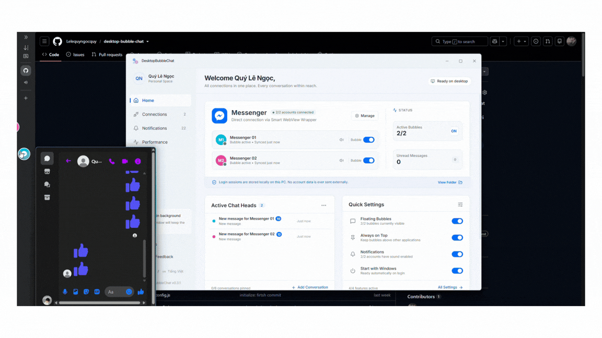
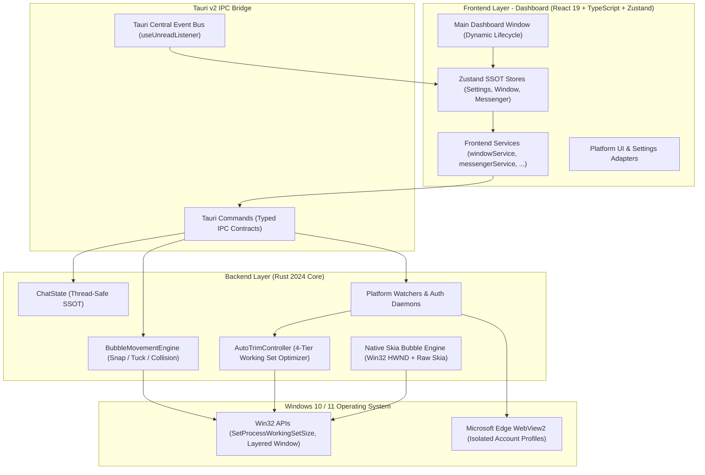

# DesktopBubbleChat

[-0078D6?style=flat-square&logo=windows>)](https://www.microsoft.com/windows)
[](https://tauri.app/)
[](https://react.dev/)
[](https://www.typescriptlang.org/)
[](https://www.rust-lang.org/)
[](LICENSE)

> Extensible, high-performance floating chat heads for Windows Desktop featuring pluggable multi-platform messaging, hardware-accelerated Win32 + Skia vector avatars, intelligent 4-tier RAM trimming, physics-driven edge docking, and zero-click interactions.

**English** | [Tiếng Việt](README.vi.md)

---

**DesktopBubbleChat** brings the fluid, non-intrusive mobile chat head experience to Windows 10 and 11 across multiple messaging networks. Built with **Tauri v2**, **React 19**, **TypeScript**, and a native **Rust (Win32 + Skia)** core, it decouples windowing, physics, and rendering from platform adapters. It runs concurrent isolated profiles inside dedicated Microsoft WebView2 sandboxes while keeping memory overhead exceptionally low via automated working-set trimming.

### Table of Contents

- [Demo](#demo)
- [Download](#download)
- [Key Features](#key-features)
- [Architecture Overview](#architecture-overview)
- [Roadmap](#roadmap)
- [Getting Started](#getting-started)
- [Usage & Shortcuts](#usage--shortcuts)
- [Security Model](#security-model)
- [Troubleshooting](#troubleshooting)
- [Maintainers](#maintainers)
- [Contributing](#contributing)
- [Disclaimer](#disclaimer)
- [License](#license)

---

## Demo



---

## Download

Ready-to-use installer for **Windows 10 / 11 (64-bit)**:

[-0078D6?style=for-the-badge&logo=windows&logoColor=white)](https://github.com/Lelequyngocquy/desktop-bubble-chat/releases/download/v0.3.1/DesktopBubbleChat_0.3.1_x64-setup.exe)

- **Direct Download**: [DesktopBubbleChat_0.3.1_x64-setup.exe](https://github.com/Lelequyngocquy/desktop-bubble-chat/releases/download/v0.3.1/DesktopBubbleChat_0.3.1_x64-setup.exe)
- **All Releases & Changelog**: [GitHub Releases](https://github.com/Lelequyngocquy/desktop-bubble-chat/releases)

---

### Key Features

- **Pure Rust Win32 + Skia Vector Avatars**:
  - Floating bubbles are **100% native Win32 Layered Windows** rendered on a dedicated thread with the **Tiny-Skia 2D vector engine**.
  - Zero WebView overhead for bubbles: no black borders, no GPU composition lag, perfect transparency, and sub-pixel anti-aliasing.
  - Interactive spring physics animation at 60 FPS.
- **Intelligent 4-Tier Auto-Trim Memory Management**:
  - Automatically manages Windows Virtual Memory via `SetProcessWorkingSetSize` across host and WebView2 process trees.
  - **Dynamic WebView2 Memory Target Level**: Automatically toggles `ICoreWebView2_19::SetMemoryUsageTargetLevel` between `Low` (when tucked or idle) and `Normal` (when active) to force Chromium to purge its V8 JavaScript heap, decode caches, and font buffers.
  - **Stripped Chromium Background Services & Process Limiter**: Injected Chromium startup flags (`--renderer-process-limit=1`, `--disable-features=Translate,OptimizationHints,CalculateNativeWinOcclusion,...`, `--disable-3d-apis`, strict cache limits) and trimmed `CoreWebView2Settings` (disabled status bar, autofill, zoom, and swipe navigation) to completely eliminate redundant Chromium background processes and bloatware strictly unneeded when only running Messenger.
  - **4 automated triggers**: 3s after bubble tucks, 2s after receiving an unread message, 5s after session preload finishes, and an idle sweeper every 5 minutes.
  - **Dynamic Dashboard Destruction**: Closing or minimizing the main dashboard destroys its window down to **0 MB RAM** (only background headless message workers persist).
  - Trims total RAM footprint from typical 500–700 MB down to **80–140 MB**.
- **Real-Time Performance Dashboard**:
  - Live per-process RAM breakdown (Host Rust, Dashboard UI, WebView2 instances, GPU processes).
  - Single-click manual memory flush ("Trim Memory") with live recovery metric.
- **Auto-Seen Prevention & Background Shield**:
  - Overrides `document.hasFocus()` and mocks DOM blur on window hide to prevent Meta Messenger Web from auto-marking unread messages as "Seen" while the chat window is hidden.
  - Multi-tier unread counter guard prevents title-flashing from wiping unread badges prematurely.
- **Concurrent Multi-Account Isolation**:
  - Run up to 5 concurrent accounts per platform in isolated browser data partitions (`profiles/<platform>_<index>`).
  - No cookie collisions, cross-account logouts, or session leakage.
- **Physics-Based Edge Snapping & Tucking**:
  - Smoothly snaps to screen edges and tucks 75% of the bubble off-screen when idle to save screen real estate.
  - Collision resolver prevents stacked bubbles from overlapping.
- **Zero-Click Hover Interaction**:
  - **Hover (100ms)** to glide out and open the docked conversation window.
  - **Leave cursor (1000ms)** to automatically close the chat window and glide the bubble back into tucked mode.
- **Cryptographically Secured In-App Auto-Updates**:
  - Integrated Tauri Updater signed with **Minisign (Ed25519)** keys to prevent malicious binary tampering.
  - Visual download progress and release notes viewer in Settings.
- **Full Personalization & System Integration**:
  - **Dark / Light Mode**: Seamless system sync with manual toggle.
  - **Bilingual Interface**: Full English and Vietnamese support with runtime reactive switching.
  - **Customizable Bubble Size**: Small (48px), Medium (56px), and Large (64px).
  - **Configurable Close Action**: Ask each time, hide to tray, or exit completely.
  - **Global Hotkey (`Ctrl + Shift + M`)**: Instant toggle for all floating bubbles.
  - **Native Notifications & Audio**: Windows Action Center toasts + per-account audio muting.

---

### Architecture Overview



<details>
<summary><b>Click to view Project Structure</b></summary>

```text
DesktopBubbleChat/
├── locales/                    # Bilingual i18n translation resources (en/, vi/)
├── scripts/                    # Automation scripts (check_env.ps1, start.ps1, status.ps1)
├── src/                        # Frontend Application (React 19 + TypeScript + Tailwind)
│   ├── components/             # Dashboard views, title bar, settings sections & UI primitives
│   ├── hooks/                  # Global listeners (useUnreadListener, useAutoUpdater, ...)
│   ├── i18n/                   # i18next runtime initialization & reactive language switching
│   ├── platforms/              # Modular Frontend Platform Adapters (e.g. messenger/)
│   ├── stores/                 # Zustand state stores (settings, window, performance, ...)
│   ├── services/               # windowService, systemService, messengerService, ...
│   └── types/                  # Typed IPC contracts, domain models, and performance types
├── src-tauri/                  # Rust Backend Core & Native OS Integration
│   ├── capabilities/           # Tauri v2 security ACL policies
│   ├── src/
│   │   ├── commands/           # IPC command handlers (bubble, system, platforms)
│   │   ├── movement/           # Physics engine, snap calculations & collision resolver
│   │   ├── platforms/          # Platform adapters (auth watchers, scrapers, lifecycle)
│   │   ├── tray/               # System tray setup & dynamic context menus
│   │   ├── utils/              # Memory trimming (AutoTrimController), win32, user_cache
│   │   ├── windows/            # Skia rendering engine & Win32 native window management
│   │   └── state.rs            # Centralized thread-safe app state
│   ├── Cargo.toml              # Rust dependencies manifest
│   └── tauri.conf.json         # Tauri v2 configuration
└── package.json
```

</details>

---

### Roadmap

| Platform               | Integration Type                   | Multi-Account Support             | Status        |
| :--------------------- | :--------------------------------- | :-------------------------------- | :------------ |
| **Facebook Messenger** | Isolated WebView2 + Native Daemons | Up to 5 Accounts (Profiles 01–05) | **Available** |
| **Telegram**           | Web / TDesktop Adapter             | Planned Multi-Account             | **Roadmap**   |
| **Zalo**               | Web Wrapper + Auth Watcher         | Planned Multi-Account             | **Roadmap**   |
| **Discord**            | Web Client / Gateway Adapter       | Planned Multi-Account             | **Roadmap**   |

---

### Getting Started

#### Prerequisites

- **Windows 10 (1903+) or Windows 11 (64-bit)**
- **Node.js**: `>= 18.0.0`
- **Rust & Cargo**: Stable (1.80+ with `x86_64-pc-windows-msvc`)
- **Visual Studio Build Tools 2022** (Desktop development with C++ Workload)
- **Microsoft Edge WebView2 Runtime** (Evergreen)

#### Installation & Setup

1. **Clone the repository**:

   ```bash
   git clone https://github.com/Lelequyngocquy/desktop-bubble-chat.git
   cd desktop-bubble-chat
   ```

2. **Install dependencies**:

   ```bash
   npm install
   ```

3. **Verify your build environment**:

   ```powershell
   npm run app:check
   ```

4. **Run in development mode**:

   ```powershell
   npm run app:start
   ```

5. **Build for production**:
   ```powershell
   npm run tauri build
   ```

---

### Usage & Shortcuts

- **`Ctrl + Shift + M`**: Master hotkey to toggle visibility of all floating bubbles.
- **Hover on Bubble**: Slides out and opens docked conversation window.
- **Leave Cursor**: Slides chat back into docked edge tucking.
- **System Tray Menu**: Right-click the taskbar tray icon to:
  - Toggle Main Dashboard
  - Show / Hide All Bubbles
  - Toggle individual accounts
  - Exit Application cleanly
- **Resource Monitoring**:
  Inspect live RAM and WebView2 usage across profiles via the in-app **Performance Dashboard** or CLI:
  ```powershell
  powershell -ExecutionPolicy Bypass -File scripts/status.ps1 -Watch
  ```

---

### Security Model

1. **Zero Cloud Intermediaries**: Messaging data flows strictly between your local client and official endpoints (`https://www.messenger.com`). No telemetry, tokens, or messages touch third-party servers.
2. **Profile Isolation**: Each account operates in an isolated user data directory (`profiles/<platform>_<index>`). Sessions, cookies, and local storage never mix.
3. **Cryptographic Updates**: In-app updater verifies binary signatures using **Minisign Ed25519** public keys prior to execution.
4. **Strict Tauri Permissions**: Strict ACL capability policies (`src-tauri/capabilities/default.json`) prevent unauthorized shell or file system operations.

---

### Troubleshooting

- **Port 1420 In Use**: Run `Stop-Process -Name "DesktopBubbleChat" -Force -ErrorAction SilentlyContinue` or launch via `npm run app:start` (which automatically clears stale ports).
- **WebView2 Process Locked**: If builds fail due to file locks on `msedgewebview2.exe`, right-click the system tray and select **Exit Application**, or terminate via PowerShell:
  ```powershell
  Get-Process msedgewebview2 -ErrorAction SilentlyContinue | Where-Object { $_.CommandLine -like "*com.desktopbubblechat.app*" } | Stop-Process -Force
  ```
- **Rust Linker Missing (`link.exe`)**: Install Visual Studio Build Tools 2022 with the "Desktop development with C++" component.

---

## Maintainers

- **Le Ngoc Quy** ([@Lelequyngocquy](https://github.com/Lelequyngocquy))

---

## Contributing

Contributions, issues, and feature requests are welcome!

1. Fork the Project
2. Create your Feature Branch (`git checkout -b feature/AmazingFeature`)
3. Commit your Changes (`git commit -m 'feat: Add some AmazingFeature'`)
4. Push to the Branch (`git push origin feature/AmazingFeature`)
5. Open a Pull Request

---

## Disclaimer

DesktopBubbleChat is an independent open-source project plays a role as mini BROWSER, and is not affiliated, associated, authorized, endorsed by, or in any way officially connected with Meta Platforms, Inc., or Facebook Messenger. The official Messenger website can be found at https://www.messenger.com.

---

## License

Distributed under the **MIT License**. See [LICENSE](LICENSE) for more information.
