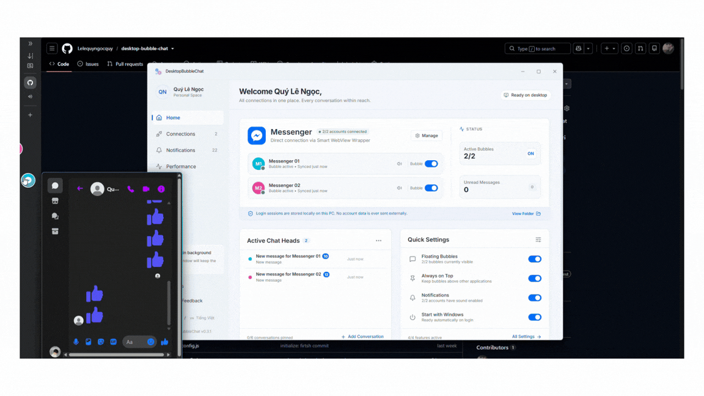
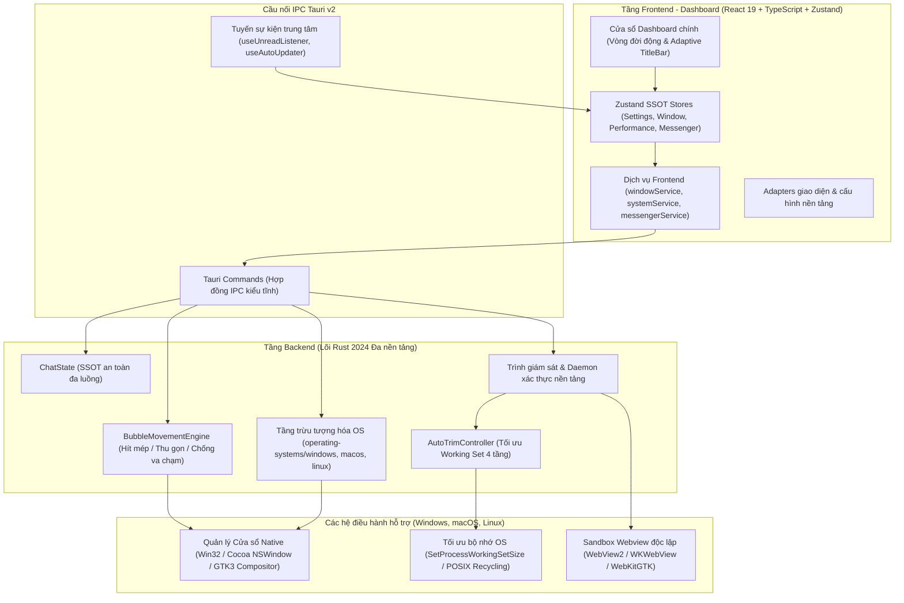

# DesktopBubbleChat

[](#tải-về--cài-đặt)
[](#tải-về--cài-đặt)
[](#tải-về--cài-đặt)
[](https://tauri.app/)
[](https://react.dev/)
[](https://www.typescriptlang.org/)
[](https://www.rust-lang.org/)
[](LICENSE)

> Ứng dụng bong bóng chat (Chat Heads) nổi mượt mà, tiện lợi trên Desktop (Windows, macOS, Linux). Hỗ trợ đa nền tảng nhắn tin, đồ họa vector native, cơ chế tối ưu RAM 4 tầng thông minh, hút mép vật lý và tương tác lướt chuột zero-click.

[English](README.md) | **Tiếng Việt**

---

**DesktopBubbleChat** mang trải nghiệm bong bóng chat (Chat Heads) mượt mà, tiện lợi từ thiết bị di động lên **Windows**, **macOS** và **Linux**. Được xây dựng trên nền tảng **Tauri v2**, **React 19**, **TypeScript** và lõi native **Rust (Tầng trừu tượng hóa phần cứng & OS)**, ứng dụng tách biệt hoàn toàn giữa engine vật lý hiển thị và adapter của từng nền tảng nhắn tin. Dự án cho phép chạy đồng thời nhiều tài khoản độc lập trong các sandbox Webview riêng biệt, đồng thời nén mức chiếm dụng bộ nhớ RAM xuống mức tối thiểu nhờ cơ chế tự động xả Working Set thông minh.

### Mục lục

- [Minh họa](#minh-họa)
- [Tải về & Cài đặt](#tải-về--cài-đặt)
  - [Các gói phát hành sẵn](#tải-về--cài-đặt)
  - [Hướng dẫn cài đặt & Xử lý sự cố người dùng](#hướng-dẫn-cài-đặt--xử-lý-sự-cố-người-dùng)
- [Tính năng nổi bật](#tính-năng-nổi-bật)
- [Tổng quan kiến trúc](#tổng-quan-kiến-trúc)
- [Lộ trình phát triển](#lộ-trình-phát-triển)
- [Khởi chạy từ mã nguồn (Dành cho Lập trình viên)](#khởi-chạy-từ-mã-nguồn-dành-cho-lập-trình-viên)
  - [Yêu cầu môi trường](#yêu-cầu-môi-trường)
  - [Các bước cài đặt](#các-bước-cài-đặt)
  - [Xử lý sự cố khi build & chạy mã nguồn](#xử-lý-sự-cố-khi-build--chạy-mã-nguồn-developer-troubleshooting)
- [Phím tắt & Khay hệ thống](#phím-tắt--khay-hệ-thống)
- [Mô hình bảo mật](#mô-hình-bảo-mật)
- [Người duy trì dự án](#người-duy-trì-dự-án)
- [Đóng góp phát triển](#đóng-góp-phát-triển)
- [Tuyên bố miễn trừ trách nhiệm](#tuyên-bố-miễn-trừ-trách-nhiệm-disclaimer)
- [Giấy phép](#giấy-phép)

---

## Minh họa



---

## Tải về & Cài đặt

Các gói phát hành chính thức phiên bản **v1.0.0**:

| Hệ điều hành | Định dạng gói | Liên kết tải về | Kiến trúc |
| :--- | :--- | :--- | :--- |
| **Windows 10 / 11** | Bộ cài đặt `.exe` | [DesktopBubbleChat_1.0.0_x64-setup.exe](https://github.com/Lelequyngocquy/desktop-bubble-chat/releases/download/v1.0.0/DesktopBubbleChat_1.0.0_x64-setup.exe) | x86_64 |
| **macOS (Apple Silicon)** | Ảnh đĩa `.dmg` | [DesktopBubbleChat_1.0.0_aarch64.dmg](https://github.com/Lelequyngocquy/desktop-bubble-chat/releases/download/v1.0.0/DesktopBubbleChat_1.0.0_aarch64.dmg) | M1/M2/M3/M4 (`aarch64`) |
| **Linux (Debian/Ubuntu)** | Gói cài `.deb` | [desktop-bubble-chat_1.0.0_amd64.deb](https://github.com/Lelequyngocquy/desktop-bubble-chat/releases/download/v1.0.0/desktop-bubble-chat_1.0.0_amd64.deb) | x86_64 (`amd64`) |
| **Linux (Fedora/RHEL)** | Gói cài `.rpm` | [DesktopBubbleChat-1.0.0-1.x86_64.rpm](https://github.com/Lelequyngocquy/desktop-bubble-chat/releases/download/v1.0.0/DesktopBubbleChat-1.0.0-1.x86_64.rpm) | x86_64 |
| **Linux (Mọi Distro)** | Gói chạy trực tiếp `.AppImage` | [DesktopBubbleChat_1.0.0_amd64.AppImage](https://github.com/Lelequyngocquy/desktop-bubble-chat/releases/download/v1.0.0/DesktopBubbleChat_1.0.0_amd64.AppImage) | x86_64 (`amd64`) |

<details>
<summary><b>Mã băm SHA-256 & Chữ ký số kiểm tra toàn vẹn</b></summary>

```text
2a2e106933967d74194a39e504e06a9ccb6628524b4b37a6d445a4f09705cfd8  DesktopBubbleChat_1.0.0_x64-setup.exe
28eeb31a019bbde895863750342815bf001364a19d20022c80e6223a67026800  DesktopBubbleChat_1.0.0_aarch64.dmg
16465999ab7eff2794a1f5bbcb353f7f6666384fcd5b2174c0fce5b0ff117151  desktop-bubble-chat_1.0.0_amd64.deb
1dbde9b6cd77007cc24001098325e0162dd85035ff6f6a24b23cf329a89e0b3c  DesktopBubbleChat-1.0.0-1.x86_64.rpm
36f5923b6771085a06a251df2b61619d6c523901b83139efb0d1f7f4602490ec  DesktopBubbleChat_1.0.0_amd64.AppImage
cc0fc815786d30ac83e88c0d63b1505cc7edec8bebaa354089b835982b3d9488  DesktopBubbleChat_1.0.0_aarch64.app.tar.gz
```

</details>

**Tất cả phiên bản & Lịch sử cập nhật**: [GitHub Releases](https://github.com/Lelequyngocquy/desktop-bubble-chat/releases)

### Hướng dẫn cài đặt & Xử lý sự cố người dùng

Hướng dẫn dành cho người dùng cài đặt các gói ứng dụng đã đóng gói sẵn:

#### 🪟 Windows
- **Cảnh báo SmartScreen ("Windows protected your PC")**:
  Do ứng dụng là mã nguồn mở mới phát hành và chưa mua chứng chỉ số doanh nghiệp EV đắt đỏ, Windows Defender SmartScreen có thể hiển thị thông báo bảo vệ. Người dùng chỉ cần nhấn **"More info" (Thông tin khác)** và chọn **"Run anyway" (Vẫn chạy)**.
- **Môi trường WebView2**:
  Windows 10 và 11 mặc định đã có sẵn Microsoft Edge WebView2 Evergreen. Nếu bạn đang dùng bản Windows rút gọn (Ghost/Lite), hãy tải [Microsoft Edge WebView2 Evergreen Bootstrapper chính thức từ Microsoft](https://developer.microsoft.com/en-us/microsoft-edge/webview2/).

#### 🍎 macOS
- **Cảnh báo Gatekeeper ("DesktopBubbleChat is damaged and can’t be opened")**:
  Do phần mềm mã nguồn mở chưa đăng ký chứng chỉ Apple Developer ID có phí, macOS Gatekeeper sẽ chặn mở và yêu cầu chuyển vào thùng rác. Để xoá cờ cách ly (quarantine flag) và mở app, bạn hãy mở **Terminal** và chạy lệnh:
  ```bash
  xattr -cr /Applications/DesktopBubbleChat.app
  ```
- **Cấp quyền Trợ năng (Accessibility) để theo dõi con trỏ chuột**:
  Để bong bóng tự động trượt ra mượt mà khi rê chuột và kích hoạt phím tắt toàn cục:
  1. Mở **Cài đặt hệ thống (System Settings)** > **Quyền riêng tư & Bảo mật (Privacy & Security)** > **Trợ năng (Accessibility)**.
  2. Bật công tắc cho phép **DesktopBubbleChat**.

#### 🐧 Linux
- **Chạy file `.AppImage` trên Ubuntu 22.04+ (Yêu cầu FUSE 2)**:
  Các bản Ubuntu gần đây không cài sẵn `libfuse2`. Nếu nhấp đúp vào AppImage không thấy phản hồi, chạy lệnh:
  ```bash
  sudo apt update && sudo apt install libfuse2
  chmod +x DesktopBubbleChat_1.0.0_amd64.AppImage
  ./DesktopBubbleChat_1.0.0_amd64.AppImage
  ```
- **Cài đặt gói `.deb` (Debian / Ubuntu / Linux Mint)**:
  Nên dùng lệnh `apt` để tự động kéo các gói phụ thuộc cần thiết:
  ```bash
  sudo apt install ./desktop-bubble-chat_1.0.0_amd64.deb
  ```
  *(Nếu đã lỡ cài bằng `dpkg -i` và báo thiếu phụ thuộc, gõ lệnh `sudo apt-get install -f` để khắc phục).*
- **Cài đặt gói `.rpm` (Fedora / RHEL / openSUSE)**:
  ```bash
  sudo dnf install ./DesktopBubbleChat-1.0.0-1.x86_64.rpm
  ```
- **Biểu tượng Khay hệ thống GNOME**:
  Giao diện GNOME Shell mặc định ẩn khay hệ thống. Để hiển thị icon trên thanh Top bar Ubuntu/GNOME:
  ```bash
  sudo apt install gnome-shell-extension-appindicator
  ```
  *(Lưu ý: Ngay cả khi không có khay hệ thống, DesktopBubbleChat vẫn có tính năng **Smart Minimize** và menu cài đặt nhanh tích hợp trực tiếp trên bong bóng chat, đảm bảo không bao giờ bị mất giao diện điều khiển).*

---

### Tính năng nổi bật

- **Lõi đồ họa Vector Native & Cửa sổ nổi Đa nền tảng**:
  - Bong bóng nổi là **cửa sổ native OS hoàn toàn trong suốt, không viền**, được vẽ bằng engine đồ họa vector tăng tốc phần cứng (**Tiny-Skia 2D vector engine** kết hợp API quản lý cửa sổ native).
  - **Windows**: Cửa sổ Win32 Layered Window với alpha per-pixel, khử răng cưa sub-pixel hoàn hảo.
  - **macOS**: Cửa sổ Cocoa `NSWindow` trong suốt native với độ sắc nét chuẩn màn hình Retina.
  - **Linux**: Cửa sổ GTK / X11-Wayland trong suốt kết hợp cơ chế xử lý tương thích compositor.
  - Không viền đen, không trễ GPU bộ tổng hợp, chuyển động vật lý lò xo 60 FPS mượt mà.
- **Giao diện Desktop thích ứng & Thanh tiêu đề Native (Adaptive TitleBar)**:
  - **macOS Traffic Lights**: 3 nút điều khiển native góc trên bên trái (Đóng, Thu nhỏ, Phóng to) kèm biểu tượng khi rê chuột, thương hiệu và tiêu đề căn giữa theo chuẩn ứng dụng macOS.
  - **Windows & Linux Controls**: Cụm nút điều khiển dạng hình chữ nhật góc trên bên phải đồng bộ với ngôn ngữ thiết kế Windows 11 Fluent và desktop Linux.
  - **Kiểu chữ hệ thống chuẩn xác (System Typography)**: Tự động kế thừa hệ thống font chữ native của từng OS (Apple SF Pro trên macOS, Segoe UI Variable trên Windows, Ubuntu / Noto Sans trên Linux).
- **Động cơ tối ưu bộ nhớ 4 tầng (Auto-Trim RAM Engine)**:
  - Tự động can thiệp xả Working Set Virtual Memory trên cả tiến trình Host và Webview (`SetProcessWorkingSetSize` trên Windows, thu hồi bộ nhớ POSIX & điều phối vòng đời tiến trình trên macOS/Linux).
  - **Điều phối bộ nhớ Webview động (Memory Usage Target Level)**: Tự động chuyển đổi giữa mức `Low` (khi bong bóng thu gọn/chạy ngầm) và `Normal` (khi mở chat tương tác) để ép Chromium / WebKit dọn sạch JavaScript heap và cache giải mã hình ảnh.
  - **Triệt tiêu tiến trình Webview thừa qua Startup Flags**: Bổ sung các cờ tối ưu hóa khởi động (`--renderer-process-limit=1`, `--disable-features=Translate,OptimizationHints,CalculateNativeWinOcclusion,...`, `--disable-3d-apis`, giới hạn cache) và cắt bỏ các thiết lập dư thừa.
  - **4 kịch bản xả RAM tự động**: Sau khi bong bóng thụt mép 3s, sau khi nhận tin nhắn 2s, sau khi preload webview 5s, và bộ quét ngầm định kỳ 5 phút/lần chống rò rỉ bộ nhớ.
  - **Tiêu hủy Dashboard động (Dynamic Destruction)**: Khi thu nhỏ hoặc đóng giao diện chính về System Tray, cửa sổ Dashboard bị tiêu hủy hoàn toàn về đúng **0 MB RAM** (chỉ giữ lại các worker lắng nghe tin nhắn nền).
  - Giảm mức chiếm dụng RAM từ 500–700 MB xuống chỉ còn **80–140 MB**.
- **Tab giám sát hiệu năng thời gian thực (Performance Dashboard)**:
  - Đo lường chi tiết mức tiêu thụ RAM của từng tiến trình (Host Rust, Dashboard UI, từng WebView Account, GPU Process).
  - Nút bấm **"Tối ưu RAM ngay"** chỉ với 1 cú click kèm số liệu dung lượng RAM vừa thu hồi được.
- **Chống Auto-Seen ngầm & Bảo vệ huy hiệu tin nhắn**:
  - Tự động can thiệp `document.hasFocus()` và mock sự kiện blur khi ẩn cửa sổ chat, ngăn chặn Meta Messenger Web tự động gửi tín hiệu "Đã xem" khi người dùng chưa xem tin nhắn.
  - Bộ bảo vệ đa tầng khóa không cho phép hiện tượng nhấp nháy tiêu đề làm mất số huy hiệu (unread badge).
- **Hỗ trợ đa tài khoản độc lập (Multi-Account)**:
  - Đăng nhập và chạy song song tối đa 5 tài khoản cùng lúc trên phân vùng dữ liệu biệt lập (`profiles/<platform>_<index>`).
  - Không xung đột cookie, không đăng xuất chéo giữa các tài khoản.
- **Hút mép màn hình & Thu gọn thông minh**:
  - Tự động hít vào mép màn hình gần nhất khi thả chuột; tự ẩn 75% diện tích bong bóng vào cạnh màn hình khi không tương tác để giải phóng tầm nhìn khi làm việc hay chơi game.
  - Bộ giải quyết va chạm (Collision Resolver) tự động xếp hàng các bong bóng cùng mép, không bị đè lên nhau.
- **Tương tác lướt chuột không cần click (Zero-Click)**:
  - **Rê chuột 100ms** vào bong bóng để trượt ra và tự động mở cửa sổ chat.
  - **Rời chuột 1000ms** để tự động đóng cửa sổ và đưa bong bóng về chế độ ẩn nép.
- **Tự động cập nhật bảo mật In-App (Auto-Updater)**:
  - Tích hợp sẵn bộ cập nhật tự động, xác thực chữ ký số bằng khóa công khai **Minisign (Ed25519)** chống mã độc can thiệp.
  - Hiển thị tiến trình tải xuống trực quan và nhật ký cập nhật (Release Notes) ngay trong Cài đặt.
- **Cá nhân hóa toàn diện & Tích hợp Hệ điều hành (Windows, macOS, Linux)**:
  - **Dark / Light Mode**: Tự động chuyển đổi theo hệ thống hoặc chỉnh thủ công.
  - **Giao diện Song ngữ**: Hỗ trợ đầy đủ Tiếng Việt và Tiếng Anh với khả năng chuyển đổi tức thì.
  - **Tùy chỉnh kích thước bong bóng**: 3 kích cỡ linh hoạt: Nhỏ (48px), Vừa (56px) và Lớn (64px).
  - **Tùy chọn hành vi khi đóng**: Hỏi mỗi lần, ẩn về khay hệ thống, hoặc thoát ứng dụng hoàn toàn.
  - **Phím tắt toàn cục (`Ctrl + Shift + M / ⌘ + Shift + M`)**: Ẩn/hiện nhanh tức thì toàn bộ bong bóng.
  - **Thông báo & Âm thanh Native**: Native toast / notification hệ thống và khả năng bật/tắt chuông từng tài khoản riêng biệt.
  - **Truy cập thư mục Profile đa nền tảng**: Nút bấm "Mở thư mục hồ sơ" mở trực tiếp trên trình quản lý tệp native (Explorer trên Windows, Finder trên macOS, file manager trên Linux).

---

### Tổng quan kiến trúc



<details>
<summary><b>Nhấn để xem cấu trúc thư mục dự án</b></summary>

```text
DesktopBubbleChat/
├── locales/                    # Tài nguyên dịch thuật đa ngữ song ngữ (en/, vi/)
├── scripts/                    # Scripts tự động hoá Node.js đa nền tảng (start, stop, build, status, check-env)
├── src/                        # Ứng dụng Frontend (React 19 + TypeScript + Tailwind)
│   ├── components/             # Các view Dashboard, TitleBar thích ứng, sections Cài đặt & UI primitives
│   ├── hooks/                  # Global listeners (useUnreadListener, useAutoUpdater, ...)
│   ├── i18n/                   # Khởi tạo i18next & chuyển đổi ngôn ngữ phản ứng
│   ├── platforms/              # Modular Frontend Platform Adapters (vd: messenger/)
│   ├── stores/                 # Zustand state stores (settings, window, performance, ...)
│   ├── services/               # windowService, systemService, messengerService, ...
│   └── types/                  # Typed IPC contracts, domain models và performance types
├── src-tauri/                  # Lõi Rust Backend & Tích hợp Đa nền tảng Multi-OS
│   ├── capabilities/           # Chính sách ACL bảo mật Tauri v2
│   ├── src/
│   │   ├── commands/           # IPC command handlers (bubble, system, platforms)
│   │   ├── core/               # State tập trung, models và logic nghiệp vụ
│   │   ├── movement/           # Physics engine, tính toán hít mép & chống va chạm
│   │   ├── operating-systems/  # Cài đặt chuyên biệt theo OS (windows/, macos/, linux/)
│   │   ├── platforms/          # Platform adapters (auth watchers, scrapers, lifecycle)
│   │   ├── presentation/       # Khởi tạo & hiển thị cửa sổ (main, bubble, chat)
│   │   ├── tray/               # Cấu hình khay hệ thống & context menu động
│   │   └── utils/              # Quản lý RAM (AutoTrimController), user_cache, paths
│   ├── Cargo.toml              # Khai báo phụ thuộc Rust
│   └── tauri.conf.json         # Cấu hình đa nền tảng Tauri v2
└── package.json
```

</details>

---

### Lộ trình phát triển

| Nền tảng               | Hình thức tích hợp                            | Đa tài khoản                       | Trạng thái   |
| :--------------------- | :-------------------------------------------- | :--------------------------------- | :----------- |
| **Facebook Messenger** | Webview độc lập (WV2/WebKit) + Rust Daemons   | Tối đa 5 tài khoản (Profile 01–05) | **Khả dụng** |
| **Telegram**           | Web / TDesktop Adapter                        | Hỗ trợ nhiều tài khoản (Dự kiến)   | **Kế hoạch** |
| **Zalo**               | Web Wrapper + Trình theo dõi Auth             | Hỗ trợ nhiều tài khoản (Dự kiến)   | **Kế hoạch** |
| **Discord**            | Web Client / Gateway Adapter                  | Hỗ trợ nhiều tài khoản (Dự kiến)   | **Kế hoạch** |

---

### Khởi chạy từ mã nguồn (Dành cho Lập trình viên)

#### Yêu cầu môi trường

- **Tất cả hệ điều hành**:
  - **Node.js**: `>= 18.0.0`
  - **Rust & Cargo**: Bản Stable (1.80+)

- **Windows**:
  - **Windows 10 (1903+) hoặc Windows 11 (64-bit)**
  - **Visual Studio Build Tools 2022** (Gói Desktop development with C++ để lấy `link.exe`)
  - **Microsoft Edge WebView2 Runtime** (Có sẵn trên Windows 10/11)

- **macOS**:
  - **macOS 10.15 (Catalina) trở lên** (Hỗ trợ Apple Silicon `aarch64` và Intel `x86_64`)
  - **Xcode Command Line Tools**: `xcode-select --install`

- **Linux**:
  - **Ubuntu 20.04+, Debian 11+, Fedora 36+, hoặc Arch Linux**
  - **Các thư viện phát triển GTK & WebKit bắt buộc**:
    - **Debian / Ubuntu**:
      ```bash
      sudo apt install libwebkit2gtk-4.1-dev build-essential curl wget file libssl-dev libayatana-appindicator3-dev librsvg2-dev
      ```
    - **Fedora**:
      ```bash
      sudo dnf install webkit2gtk4.1-devel openssl-devel libappindicator-gtk3-devel librsvg2-devel
      ```
    - **Arch Linux**:
      ```bash
      sudo pacman -S webkit2gtk-4.1 libappindicator-gtk3 librsvg
      ```

#### Các bước cài đặt

1. **Clone mã nguồn**:

   ```bash
   git clone https://github.com/Lelequyngocquy/desktop-bubble-chat.git
   cd desktop-bubble-chat
   ```

2. **Cài đặt dependencies**:

   ```bash
   npm install
   ```

3. **Kiểm tra tương thích môi trường**:

   ```bash
   npm run app:check
   ```

4. **Chạy ở chế độ Development**:

   ```bash
   npm run app:start
   ```

5. **Đóng gói bản cài đặt Production**:

   ```bash
   npm run app:build
   # hoặc: npm run tauri build
   ```

6. **Dọn dẹp tiến trình nền**:

   ```bash
   npm run app:stop
   ```

#### Xử lý sự cố khi build & chạy mã nguồn (Developer Troubleshooting)

- **Xung đột cổng 1420 hoặc tiến trình chạy ngầm**:
  Nếu Vite dev server báo lỗi cổng 1420 đang bị chiếm dụng do tiến trình cũ chưa tắt:
  ```bash
  npm run app:stop
  ```
  *(Khi chạy `npm run app:start`, script cũng tự động phát hiện và dọn dẹp sạch sẽ các cổng/tiến trình rác).*
- **Lỗi khoá tệp hoặc tiến trình khi build**:
  Nếu `npm run app:build` báo lỗi tệp `msedgewebview2.exe` hoặc `DesktopBubbleChat.exe` đang bị khoá do đang chạy ngầm, hãy chạy:
  ```bash
  npm run app:stop
  ```
- **Lỗi thiếu trình liên kết Rust (Linker)**:
  - **Windows (`link.exe not found`)**: Cài đặt Visual Studio Build Tools 2022 và chọn gói "Desktop development with C++".
  - **macOS (`clang not found`)**: Chạy lệnh `xcode-select --install` trong Terminal.
  - **Linux (`cc / ld not found`)**: Cài đặt bộ công cụ build cơ bản: `sudo apt install build-essential pkg-config`.

---

### Phím tắt & Khay hệ thống

- **`Ctrl + Shift + M / ⌘ + Shift + M`**: Phím tắt bật/tắt tức thì toàn bộ bong bóng chat trên màn hình (hỗ trợ cả phím Command trên Mac và Control trên Windows/Linux).
- **Rê chuột vào bong bóng**: Trượt ra và mở cửa sổ chat kết nối.
- **Rời chuột khỏi cửa sổ**: Đóng chat và thụt gọn bong bóng vào cạnh màn hình.
- **Menu chuột phải System Tray**:
  - Mở / Đóng Trang chủ (Main Dashboard)
  - Bật / Ẩn tất cả bong bóng
  - Bật / Tắt hiển thị từng tài khoản riêng biệt
  - Thoát ứng dụng an toàn
- **Giám sát tài nguyên**:
  Theo dõi mức chiếm dụng RAM chi tiết qua tab **Performance Dashboard** trên app hoặc qua CLI đa nền tảng:
  ```bash
  npm run app:perf -- --watch
  ```

---

### Mô hình bảo mật

1. **Không sử dụng máy chủ trung gian**: Dữ liệu tin nhắn truyền trực tiếp giữa máy cục bộ của bạn và máy chủ chính thức của nền tảng (`https://www.messenger.com`). Tuyệt đối không thu thập telemetry, tokens hay tin nhắn.
2. **Cách ly Profile tuyệt đối**: Dữ liệu mỗi tài khoản được lưu trong thư mục riêng (`profiles/<platform>_<index>`). Cookie, token đăng nhập và cache hoàn toàn tách biệt.
3. **Cập nhật bảo mật bằng chữ ký số**: Bộ cài cập nhật được xác thực bằng chữ ký số **Minisign Ed25519** trước khi thực thi nhằm bảo vệ người dùng trước các nguy cơ tấn công chuỗi cung ứng.
4. **Cơ chế phân quyền Tauri v2 chặt chẽ**: Quy định chi tiết trong file `src-tauri/capabilities/default.json`, ngăn chặn webview thực thi các lệnh shell hoặc truy cập tệp tin trái phép.

---

## Người duy trì dự án

- **Lê Ngọc Quý** ([@Lelequyngocquy](https://github.com/Lelequyngocquy))

---

## Đóng góp phát triển

Mọi đóng góp, báo cáo lỗi (issues) và yêu cầu tính năng (feature requests) đều luôn được chào đón!

1. Fork Dự án
2. Tạo Nhánh Tính năng mới (`git checkout -b feature/AmazingFeature`)
3. Commit Thay đổi của bạn (`git commit -m 'feat: Add some AmazingFeature'`)
4. Đẩy lên Nhánh của bạn (`git push origin feature/AmazingFeature`)
5. Mở một Pull Request

---

## Tuyên bố miễn trừ trách nhiệm (Disclaimer)

DesktopBubbleChat là một dự án mã nguồn mở độc lập đóng vai trò như một mini BROWSER và không liên kết, liên doanh, ủy quyền, chứng thực hoặc kết nối chính thức dưới bất kỳ hình thức nào với Meta Platforms, Inc. hoặc Facebook Messenger. Trang web chính thức của Messenger có tại https://www.messenger.com.

---

## Giấy phép

Dự án được phân phối dưới giấy phép **MIT License**. Xem thêm tại [LICENSE](LICENSE).
