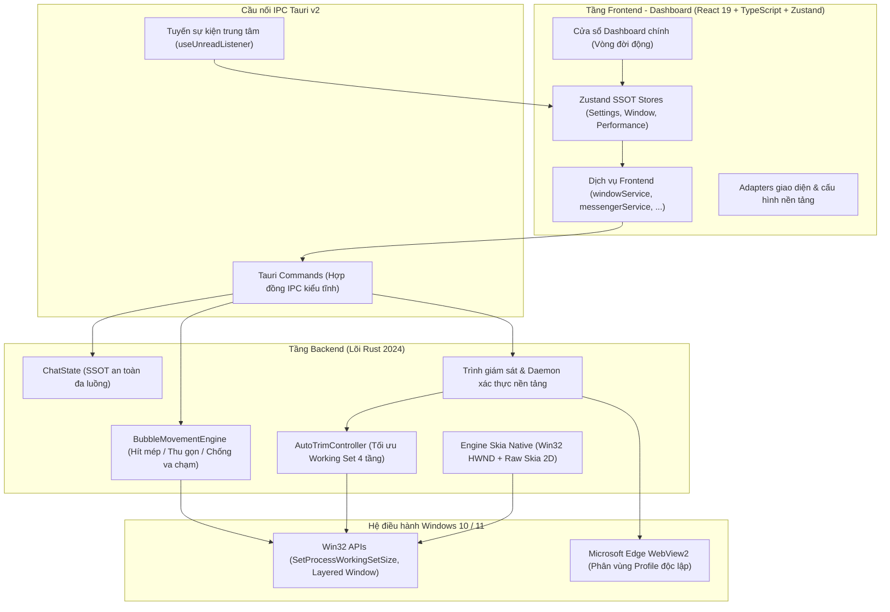

# DesktopBubbleChat

[-0078D6?style=flat-square&logo=windows>)](https://www.microsoft.com/windows)
[](https://tauri.app/)
[](https://react.dev/)
[](https://www.typescriptlang.org/)
[](https://www.rust-lang.org/)
[](LICENSE)

> Ứng dụng bong bóng chat (Chat Heads) nổi mượt mà, tiện lợi trên Windows Desktop. Hỗ trợ đa nền tảng, đồ họa vector Win32 + Skia, cơ chế tối ưu RAM 4 tầng thông minh, hút mép vật lý và tương tác lướt chuột zero-click.

[English](README.md) | **Tiếng Việt**

---

**DesktopBubbleChat** mang trải nghiệm bong bóng chat (Chat Heads) mượt mà, tiện lợi từ thiết bị di động lên hệ điều hành Windows 10 và 11. Được xây dựng trên nền tảng **Tauri v2**, **React 19**, **TypeScript** và lõi native **Rust (Win32 + Skia)**, ứng dụng tách biệt hoàn toàn giữa engine vật lý hiển thị và adapter của từng nền tảng nhắn tin. Dự án cho phép chạy đồng thời nhiều tài khoản độc lập trong các sandbox WebView2 riêng biệt, đồng thời nén mức chiếm dụng bộ nhớ RAM xuống mức tối thiểu nhờ cơ chế tự động xả Working Set thông minh.

### Mục lục

- [Minh họa](#minh-họa)
- [Tính năng nổi bật](#tính-năng-nổi-bật)
- [Tổng quan kiến trúc](#tổng-quan-kiến-trúc)
- [Lộ trình phát triển](#lộ-trình-phát-triển)
- [Cài đặt & Khởi chạy](#cài-đặt--khởi-chạy)
- [Phím tắt & Khay hệ thống](#phím-tắt--khay-hệ-thống)
- [Mô hình bảo mật](#mô-hình-bảo-mật)
- [Xử lý sự cố thường gặp](#xử-lý-sự-cố-thường-gặp)
- [Người duy trì dự án](#người-duy-trì-dự-án)
- [Đóng góp phát triển](#đóng-góp-phát-triển)
- [Tuyên bố miễn trừ trách nhiệm](#tuyên-bố-miễn-trừ-trách-nhiệm-disclaimer)
- [Giấy phép](#giấy-phép)

---

## Minh họa


### Tính năng nổi bật

- **Lõi đồ họa Vector Rust Win32 + Skia (Không dùng WebView cho bong bóng)**:
  - Bong bóng nổi là **cửa sổ Win32 Layered Window 100% native**, được vẽ bởi luồng riêng biệt sử dụng thư viện đồ họa **Tiny-Skia**.
  - Không viền đen, không lỗi bóng đổ trong suốt, không trễ GPU, khử răng cưa sub-pixel hoàn hảo.
  - Hiệu ứng vật lý lò xo (Spring Physics) đạt tốc độ khung hình 60 FPS mượt mà.
- **Động cơ tối ưu bộ nhớ 4 tầng (Auto-Trim RAM Engine)**:
  - Tự động can thiệp vào Windows Virtual Memory Manager (`SetProcessWorkingSetSize`) trên toàn bộ cây tiến trình Host và WebView2.
  - **4 kịch bản xả RAM tự động**: Sau khi bong bóng thụt mép 3s, sau khi nhận tin nhắn 2s, sau khi preload webview 5s, và bộ quét ngầm định kỳ 5 phút/lần chống rò rỉ bộ nhớ.
  - **Tiêu hủy Dashboard động (Dynamic Destruction)**: Khi thu nhỏ hoặc đóng giao diện chính về System Tray, cửa sổ Dashboard bị tiêu hủy hoàn toàn về đúng **0 MB RAM** (chỉ giữ lại các worker lắng nghe tin nhắn nền).
  - Giảm mức chiếm dụng RAM từ 500–700 MB xuống chỉ còn **80–140 MB**.
- **Tab giám sát hiệu năng thời gian thực (Performance Dashboard)**:
  - Đo lường chi tiết mức tiêu thụ RAM của từng tiến trình (Host Rust, Dashboard UI, từng WebView2 Account, GPU Process).
  - Nút bấm **"Tối ưu RAM ngay"** chỉ với 1 cú click kèm số liệu dung lượng RAM vừa thu hồi được.
- **Chống Auto-Seen ngầm & Bảo vệ huy hiệu tin nhắn**:
  - Tự động can thiệp `document.hasFocus()` và mock sự kiện blur khi ẩn cửa sổ chat, ngăn chặn Meta Messenger Web tự động gửi tín hiệu "Đã xem" khi người dùng chưa xem tin nhắn.
  - Bộ bảo vệ đa tầng khóa không cho phép hiện tượng nhấp nháy tiêu đề làm mất số huy hiệu (unread badge).
- **Hỗ trợ đa tài khoản độc lập (Multi-Account)**:
  - Đăng nhập và chạy song song tối đa 5 tài khoản cùng lúc trên phân vùng dữ liệu biệt lập (`profiles/<platform>_<index>`).
  - Không xung đột cookie, không đăng xuất chéo giữa các tài khoản.
- **Hút mép màn hình & Thu gọn thông minh**:
  - Tự động hít vào mép màn hình gần nhất khi thả chuột; tự ẩn 75% diện tích bong bóng vào cạnh màn hình khi không tương tác để giải phóng tầm nhìn khi làm việc hay chơi game.
  - Bộ giải quyết va chạm (Collision Resolver) tự động xếp hàng các bong bóng cùng mép, không bị đè lên nhau.
- **Tương tác lướt chuột không cần click (Zero-Click)**:
  - **Rê chuột 100ms** vào bong bóng để trượt ra và tự động mở cửa sổ chat.
  - **Rời chuột 1000ms** để tự động đóng cửa sổ và đưa bong bóng về chế độ ẩn nép.
- **Tự động cập nhật bảo mật In-App (Auto-Updater)**:
  - Tích hợp sẵn bộ cập nhật tự động, xác thực chữ ký số bằng khóa công khai **Minisign (Ed25519)** chống mã độc can thiệp.
  - Hiển thị tiến trình tải xuống trực quan và nhật ký cập nhật (Release Notes) ngay trong Cài đặt.
- **Cá nhân hóa toàn diện & Tích hợp Windows**:
  - **Dark / Light Mode**: Tự động chuyển đổi theo hệ thống hoặc chỉnh thủ công.
  - **Giao diện Song ngữ**: Hỗ trợ đầy đủ Tiếng Việt và Tiếng Anh với khả năng chuyển đổi tức thì.
  - **Tùy chỉnh kích thước bong bóng**: 3 kích cỡ linh hoạt: Nhỏ (48px), Vừa (56px) và Lớn (64px).
  - **Tùy chọn hành vi khi đóng**: Hỏi mỗi lần, ẩn về khay hệ thống, hoặc thoát ứng dụng hoàn toàn.
  - **Phím tắt toàn cục (`Ctrl + Shift + M`)**: Ẩn/hiện nhanh tức thì toàn bộ bong bóng.
  - **Thông báo & Âm thanh Native**: Windows Action Center toast và khả năng bật/tắt chuông từng tài khoản riêng biệt.

---

### Tổng quan kiến trúc



<details>
<summary><b>Nhấn để xem cấu trúc thư mục dự án</b></summary>

```text
DesktopBubbleChat/
├── locales/                    # Tài nguyên dịch thuật đa ngữ song ngữ (en/, vi/)
├── scripts/                    # Scripts tự động hoá (check_env.ps1, start.ps1, status.ps1)
├── src/                        # Ứng dụng Frontend (React 19 + TypeScript + Tailwind)
│   ├── components/             # Các view Dashboard, TitleBar, sections Cài đặt & UI primitives
│   ├── hooks/                  # Global listeners (useUnreadListener, useAutoUpdater, ...)
│   ├── i18n/                   # Khởi tạo i18next & chuyển đổi ngôn ngữ phản ứng
│   ├── platforms/              # Modular Frontend Platform Adapters (vd: messenger/)
│   ├── stores/                 # Zustand state stores (settings, window, performance, ...)
│   ├── services/               # windowService, systemService, messengerService, ...
│   └── types/                  # Typed IPC contracts, domain models và performance types
├── src-tauri/                  # Lõi Rust Backend & Tích hợp Windows Native
│   ├── capabilities/           # Chính sách ACL bảo mật Tauri v2
│   ├── src/
│   │   ├── commands/           # IPC command handlers (bubble, system, platforms)
│   │   ├── movement/           # Physics engine, tính toán hít mép & chống va chạm
│   │   ├── platforms/          # Platform adapters (auth watchers, scrapers, lifecycle)
│   │   ├── tray/               # Cấu hình khay hệ thống & context menu động
│   │   ├── utils/              # Quản lý RAM (AutoTrimController), win32, user_cache
│   │   ├── windows/            # Skia rendering engine & quản lý cửa sổ native Win32
│   │   └── state.rs            # Trạng thái tập trung an toàn đa luồng
│   ├── Cargo.toml              # Khai báo phụ thuộc Rust
│   └── tauri.conf.json         # Cấu hình Tauri v2
└── package.json
```

</details>

---

### Lộ trình phát triển

| Nền tảng               | Hình thức tích hợp                | Đa tài khoản                       | Trạng thái   |
| :--------------------- | :-------------------------------- | :--------------------------------- | :----------- |
| **Facebook Messenger** | WebView2 độc lập + Rust Daemon    | Tối đa 5 tài khoản (Profile 01–05) | **Khả dụng** |
| **Telegram**           | Web / TDesktop Adapter            | Hỗ trợ nhiều tài khoản (Dự kiến)   | **Kế hoạch** |
| **Zalo**               | Web Wrapper + Trình theo dõi Auth | Hỗ trợ nhiều tài khoản (Dự kiến)   | **Kế hoạch** |
| **Discord**            | Web Client / Gateway Adapter      | Hỗ trợ nhiều tài khoản (Dự kiến)   | **Kế hoạch** |

---

### Cài đặt & Khởi chạy

#### Yêu cầu môi trường

- **Hệ điều hành**: Windows 10 (1903+) hoặc Windows 11 (64-bit)
- **Node.js**: `>= 18.0.0`
- **Rust & Cargo**: Bản Stable (1.80+ với target `x86_64-pc-windows-msvc`)
- **Visual Studio Build Tools 2022** (Gói Desktop development with C++ để lấy `link.exe`)
- **Microsoft Edge WebView2 Runtime** (Có sẵn trên Win 10/11)

#### Các bước cài đặt

1. **Clone mã nguồn**:

   ```bash
   git clone https://github.com/Lelequyngocquy/desktop-bubble-chat.git
   cd desktop-bubble-chat
   ```

2. **Cài đặt dependencies**:

   ```bash
   npm install
   ```

3. **Kiểm tra tương thích môi trường**:

   ```powershell
   npm run app:check
   ```

4. **Chạy ở chế độ Development**:

   ```powershell
   npm run app:start
   ```

5. **Đóng gói bản cài đặt Production**:
   ```powershell
   npm run tauri build
   ```

---

### Phím tắt & Khay hệ thống

- **`Ctrl + Shift + M`**: Phím tắt bật/tắt hiển thị toàn bộ bong bóng chat trên màn hình.
- **Rê chuột vào bong bóng**: Trượt ra và mở cửa sổ chat kết nối.
- **Rời chuột khỏi cửa sổ**: Đóng chat và thụt gọn bong bóng vào cạnh màn hình.
- **Menu chuột phải System Tray**:
  - Mở / Đóng Trang chủ (Main Dashboard)
  - Bật / Ẩn tất cả bong bóng
  - Bật / Tắt hiển thị từng tài khoản riêng biệt
  - Thoát ứng dụng an toàn
- **Giám sát tài nguyên**:
  Theo dõi mức chiếm dụng RAM chi tiết qua tab **Performance Dashboard** trên app hoặc qua CLI:
  ```powershell
  powershell -ExecutionPolicy Bypass -File scripts/status.ps1 -Watch
  ```

---

### Mô hình bảo mật

1. **Không sử dụng máy chủ trung gian**: Dữ liệu tin nhắn truyền trực tiếp giữa máy cục bộ của bạn và máy chủ chính thức của nền tảng (`https://www.messenger.com`). Tuyệt đối không thu thập telemetry, tokens hay tin nhắn.
2. **Cách ly Profile tuyệt đối**: Dữ liệu mỗi tài khoản được lưu trong thư mục riêng (`profiles/<platform>_<index>`). Cookie, token đăng nhập và cache hoàn toàn tách biệt.
3. **Cập nhật bảo mật bằng chữ ký số**: Bộ cài cập nhật được xác thực bằng chữ ký số **Minisign Ed25519** trước khi thực thi nhằm bảo vệ người dùng trước các nguy cơ tấn công chuỗi cung ứng.
4. **Cơ chế phân quyền Tauri v2 chặt chẽ**: Quy định chi tiết trong file `src-tauri/capabilities/default.json`, ngăn chặn webview thực thi các lệnh shell hoặc truy cập tệp tin trái phép.

---

### Xử lý sự cố thường gặp

- **Lỗi cổng 1420 đang bị chiếm dụng (`Port 1420 is already in use`)**: Chạy lệnh `Stop-Process -Name "DesktopBubbleChat" -Force -ErrorAction SilentlyContinue` hoặc khởi động bằng `npm run app:start` (script sẽ tự động giải phóng port).
- **Lỗi khoá file `msedgewebview2.exe` khi build**: Do tiến trình WebView2 cũ chưa tắt hẳn. Nhấp chuột phải vào khay hệ thống chọn **Thoát ứng dụng**, hoặc gõ lệnh PowerShell:
  ```powershell
  Get-Process msedgewebview2 -ErrorAction SilentlyContinue | Where-Object { $_.CommandLine -like "*com.desktopbubblechat.app*" } | Stop-Process -Force
  ```
- **Lỗi thiếu linker Rust (`link.exe not found`)**: Cần cài đặt **Visual Studio Build Tools 2022** và tích chọn mục **Desktop development with C++**.

---

## Người duy trì dự án

- **Lê Ngọc Quý** ([@Lelequyngocquy](https://github.com/Lelequyngocquy))

---

## Đóng góp phát triển

Mọi đóng góp, báo cáo lỗi (issues) và yêu cầu tính năng (feature requests) đều luôn được chào đón!

1. Fork Dự án
2. Tạo Nhánh Tính năng mới (`git checkout -b feature/AmazingFeature`)
3. Commit Thay đổi của bạn (`git commit -m 'feat: Add some AmazingFeature'`)
4. Đẩy lên Nhánh của bạn (`git push origin feature/AmazingFeature`)
5. Mở một Pull Request

---

## Tuyên bố miễn trừ trách nhiệm (Disclaimer)

DesktopBubbleChat là một dự án mã nguồn mở độc lập đóng vai trò như một mini BROWSER và không liên kết, liên doanh, ủy quyền, chứng thực hoặc kết nối chính thức dưới bất kỳ hình thức nào với Meta Platforms, Inc. hoặc Facebook Messenger. Trang web chính thức của Messenger có tại https://www.messenger.com.

---

## Giấy phép

Dự án được phân phối dưới giấy phép **MIT License**. Xem thêm tại [LICENSE](LICENSE).
