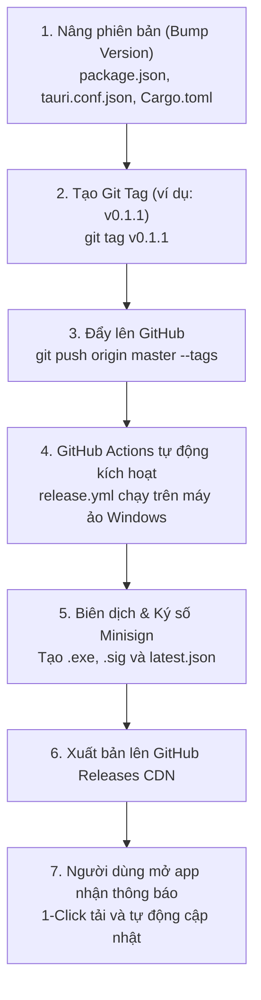

# Hướng Dẫn Phát Hành Phiên Bản Mới (Release Guide) - DesktopBubbleChat

Tài liệu này cung cấp quy trình chuẩn từ A đến Z để đóng gói, ký số mật mã và phát hành phiên bản mới của ứng dụng **DesktopBubbleChat**. 

Hệ thống sử dụng **GitHub Actions CI/CD** kết hợp với **Tauri v2 Auto-Updater** và chữ ký số **Minisign Ed25519**, cho phép phân phối bản cập nhật hoàn toàn tự động tới người dùng chỉ qua 1 lệnh Git Tag.

---

## 1. Sơ Đồ Quy Trình Phát Hành (Release Pipeline)



---

## 2. Quy Tắc Đặt Tên Phiên Bản (Semantic Versioning)

Dự án tuân theo tiêu chuẩn **SemVer (Semantic Versioning)** có định dạng:

$$\mathbf{MAJOR.MINOR.PATCH}$$

| Thành phần | Khi nào tăng số? | Ví dụ chuyển đổi |
| :--- | :--- | :--- |
| **PATCH** (Bản vá) | Khi bạn sửa lỗi nhỏ (bug fixes), tinh chỉnh giao diện, tối ưu hiệu năng mà không thêm tính năng mới. | `0.1.0` $\rightarrow$ `0.1.1` |
| **MINOR** (Tính năng mới) | Khi bạn bổ sung tính năng mới, thêm nền tảng chat mới (Zalo, Telegram), thêm tùy chọn cài đặt mới. | `0.1.1` $\rightarrow$ `0.2.0` |
| **MAJOR** (Bản đột phá) | Khi có sự thay đổi kiến trúc toàn diện, cấu trúc lưu trữ thay đổi lớn hoặc phiên bản chính thức đầu tiên. | `0.2.0` $\rightarrow$ `1.0.0` |

> [!IMPORTANT]
> **Quy tắc gắn Tag Git:**
> Tag Git trên GitHub **bắt buộc phải có chữ `v` ở đầu** (ví dụ: `v0.1.1`, `v0.2.0`), vì GitHub Actions workflow được thiết lập để lắng nghe pattern `v*`.

---

## 3. Cài Đặt Ban Đầu Trên GitHub (Chỉ cần làm 1 lần duy nhất)

Trước khi phát hành bản build đầu tiên, bạn cần cấp Secret cho GitHub Actions để máy ảo có thể ký số gói cài đặt:

1. Truy cập vào Repository trên trình duyệt:
   `https://github.com/Lelequyngocquy/desktop-bubble-chat/settings/secrets/actions`
2. Bấm nút **New repository secret**.
3. Điền các trường:
   - **Name**: `TAURI_SIGNING_PRIVATE_KEY`
   - **Secret**: Copy toàn bộ nội dung từ file local `src-tauri/tauri-signing.key` dán vào:
     ```text
     dW50cnVzdGVkIGNvbW1lbnQ6IHJzaWduIGVuY3J5cHRlZCBzZWNyZXQga2V5ClJXUlRZMEl5UmdQL2xxdHErZEtweHV1NFVkM2Z3LzZmK1BoSUU3MmxMMk42LzFvMldTMEFBQkFBQUFBQUFBQUFBQUlBQUFBQUQvbGwyamd0YXRRUHdaeTY2TGRiQjRpL0o1a0V5SnJkd25WVjlMMlNEV04xalhoWmdWRHBuRVlFdEZOZVNGVjZORTJTWHlKVUVXWkh0ZGhzNzU2MURqNWFDankySDFJZ3ViZkxvN2pjSGRyUkV4MTBwVlBKT2RxQjlYcHdKYkY1Sk1FOXlaMUFnU3M9Cg==
     ```
4. Bấm **Add secret** để lưu lại.

> [!CAUTION]
> File `tauri-signing.key` chứa khóa bí mật tuyệt đối. Tuyệt đối **không được xóa** file này trên máy bạn và **không bao giờ commit** nó lên Git công khai. Dự án đã tự động cấu hình `.gitignore` để bảo vệ file này.

---

## 4. Các Bước Chi Tiết Để Phát Hành Bản Mới

### Bước 1: Đồng Bộ Số Phiên Bản Tại 3 File

Mở 3 file sau và thay đổi số phiên bản cho khớp nhau (ví dụ nâng lên `0.1.1`):

1. **[`package.json`](file:///D:/DesktopBubbleChat/package.json)** (Dòng 4):
   ```json
   "version": "0.1.1",
   ```
2. **[`src-tauri/tauri.conf.json`](file:///D:/DesktopBubbleChat/src-tauri/tauri.conf.json)** (Dòng 4):
   ```json
   "version": "0.1.1",
   ```
3. **[`src-tauri/Cargo.toml`](file:///D:/DesktopBubbleChat/src-tauri/Cargo.toml)** (Dòng 3):
   ```toml
   version = "0.1.1"
   ```

*(Cách nhanh nhất: Sử dụng script tự động hóa `scripts/versioning.ps1`):*
```bash
# Cách 1: Sử dụng lệnh npm (tiện lợi)
npm run app:version -- -Version v0.1.1

# Cách 2: Chạy trực tiếp file PowerShell
powershell -ExecutionPolicy Bypass -File scripts/versioning.ps1 v0.1.1

# Cách 3: Chạy không tham số (script sẽ hỏi và đợi bạn nhập số phiên bản)
powershell -ExecutionPolicy Bypass -File scripts/versioning.ps1
```

---

### Bước 2: Kiểm Tra Nhanh Trước Khi Đóng Gói (Sanity Check)

Chạy lệnh build thử ở máy local để đảm bảo code không phát sinh lỗi cú pháp hay lỗi TypeScript:

```bash
npm run build
```

Nếu kết quả xuất hiện `✓ built in ...s` là code hoàn toàn sạch sẽ và sẵn sàng phát hành.

---

### Bước 3: Commit Code & Tạo Tag Đẩy Lên GitHub

Mở Terminal tại thư mục dự án và thực hiện tuần tự 4 lệnh sau:

```bash
# 1. Thêm tất cả thay đổi vào stage
git add .

# 2. Tạo commit phát hành phiên bản mới
git commit -m "chore(release): v0.1.1"

# 3. Tạo tag phiên bản tương ứng (lưu ý có chữ 'v')
git tag v0.1.1

# 4. Đẩy commit và tag lên nhánh chính trên GitHub
git push origin master --tags
```

---

### Bước 4: Theo Dõi GitHub Actions Tự Động Xây Dựng Bản Cài

Ngay sau khi lệnh `git push --tags` hoàn tất:

1. Mở trang quản lý Actions:
   `https://github.com/Lelequyngocquy/desktop-bubble-chat/actions`
2. Bạn sẽ thấy một Workflow tên là **"Release & Publish DesktopBubbleChat"** đang chạy với biểu tượng xoay vàng.
3. Máy ảo Windows của GitHub sẽ:
   - Tải source code và cài đặt môi trường Rust + Node.js.
   - Biên dịch gói cài đặt Windows Installer (`DesktopBubbleChat_0.1.1_x64-setup.exe` / `.msi`).
   - Tự động ký số file `.sig` bằng Private Key trong GitHub Secrets.
   - Tự động tạo file mô tả cập nhật `latest.json`.
   - Tạo bài viết **Release v0.1.1** trên GitHub Releases và đính kèm đầy đủ tài nguyên.
4. Thời gian hoàn tất thông thường: **khoảng 3 đến 5 phút**.

---

## 5. Trải Nghiệm Cập Nhật Phía Người Dùng (Client Auto-Update)

Sau khi GitHub Actions xuất bản thành công bản `v0.1.1`:

1. Bất kỳ người dùng nào đang mở ứng dụng bản cũ (ví dụ `v0.1.0`):
   - Chấm tròn xanh phát sáng tự động xuất hiện trên menu **Cập nhật ứng dụng** ở thanh Sidebar.
2. Khi người dùng bấm vào tab **Cập nhật ứng dụng**:
   - Tiêu đề sẽ hiển thị: *"Đã có bản cập nhật mới: v0.1.1"*.
   - Người dùng bấm nút **`[Tải bản cập nhật]`**.
   - Thanh tiến trình hiển thị % tải, dung lượng thực tế và tốc độ mạng thời gian thực.
3. Khi tải xong 100%:
   - Nút **`[Khởi động lại để cập nhật]`** màu xanh lá nổi bật sẽ xuất hiện.
   - Người dùng bấm nút, ứng dụng sẽ tự động đóng các cửa sổ nhẹ nhàng, chạy bộ cài nâng cấp đè và khởi động lại với phiên bản `v0.1.1` mà không làm mất cấu hình cá nhân.

---

## 6. Xử Lý Các Tình Huống Ngoại Lệ (Troubleshooting)

### Trường hợp 1: Tạo nhầm tag hoặc muốn hủy tag phát hành
Nếu bạn vô tình tạo nhầm tag (ví dụ gõ nhầm `v0.1.2` thay vì `v0.1.1`) và đã push lên GitHub:
```bash
# Xóa tag ở máy local
git tag -d v0.1.2

# Xóa tag trên remote GitHub
git push origin --delete v0.1.2
```

### Trường hợp 2: GitHub Actions báo lỗi `Resource not accessible by integration`
- Nguyên nhân: Repository chưa bật quyền ghi (Write permission) cho GitHub Actions.
- Cách xử lý:
  1. Vào **Settings** > **Actions** > **General**.
  2. Kéo xuống mục **Workflow permissions**.
  3. Chọn **Read and write permissions** rồi bấm **Save**.

### Trường hợp 3: Ứng dụng báo "Không thể kết nối đến máy chủ cập nhật"
- Kiểm tra xem file `latest.json` đã có mặt trên trang Releases của repository chưa:
  `https://github.com/Lelequyngocquy/desktop-bubble-chat/releases/latest/download/latest.json`
- Đảm bảo Repository ở chế độ **Public** (đối với gói tài khoản GitHub miễn phí để tải file release qua CDN công khai không cần token).

---

*Tài liệu được cập nhật tự động đồng bộ theo kiến trúc Tauri v2 của dự án DesktopBubbleChat.*
